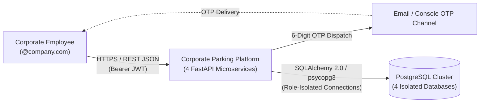
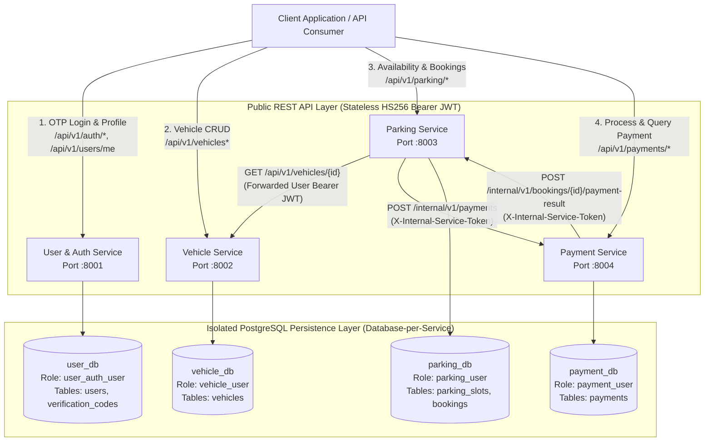
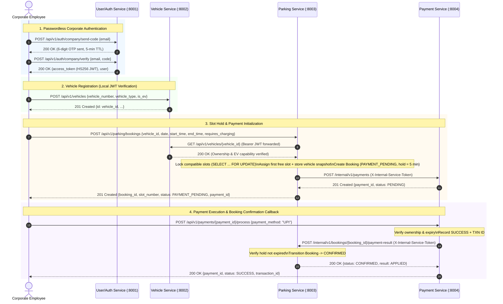

# System Architecture — Corporate Parking Management Platform

## 1. Executive Summary

The **Corporate Parking Management Platform** is a four-service Python/FastAPI microservices backend with strict **Database-per-Service** isolation on PostgreSQL. It enables corporate employees to authenticate via passwordless domain-restricted email OTP, manage personal vehicles (Car/Bike, ICE/EV), check real-time slot availability, hold and book compatible slots with pessimistic row locking, and complete simulated digital payments via asynchronous-style internal service callbacks.

| Attribute | Specification |
| :--- | :--- |
| **Architectural Style** | Domain-aligned Microservices + Database-per-Service |
| **Runtime & Framework** | Python 3.13, FastAPI, Pydantic v2, SQLAlchemy 2.0, Alembic |
| **Data Persistence** | PostgreSQL 15+ (4 isolated databases, 4 isolated DB roles) |
| **User Authentication** | Corporate Email OTP + Stateless HS256 Bearer JWT (`JWT_SECRET_KEY`) |
| **Service-to-Service Auth** | Token Propagation (`Bearer JWT`) + Shared M2M Secret (`X-Internal-Service-Token`) |
| **Concurrency Control** | PostgreSQL `SELECT ... FOR UPDATE` row-level locking + 5-minute lazy hold expiry |

---

## 2. System Context Diagram

---

## 3. Microservices & Database-per-Service Architecture

Each microservice owns its bounded context, runs as an independent process, and connects exclusively to its own PostgreSQL database using a dedicated least-privilege database role (`REVOKE CONNECT ... FROM PUBLIC`). Cross-database SQL joins and foreign keys do not exist.

---

## 4. Service Responsibility & Ownership Matrix

| Service | Port | Database & Role | Owned Entities | Core Responsibilities |
| :--- | :---: | :--- | :--- | :--- |
| **User & Auth Service** | `8001` | `user_db` (`user_auth_user`) | `users`, `verification_codes` | Corporate domain enforcement (`@company.com`), CSPRNG 6-digit OTP lifecycle, JIT user provisioning, HS256 JWT issuance, `/users/me` profile lookup. |
| **Vehicle Service** | `8002` | `vehicle_db` (`vehicle_user`) | `vehicles` | License plate normalization, duplicate active plate prevention, user-scoped CRUD, soft deactivation (`is_active=False`). |
| **Parking Service** | `8003` | `parking_db` (`parking_user`) | `parking_slots`, `bookings` | 100-slot inventory (`C01`–`C60`, `B01`–`B40`), operating window & EV compatibility rules, `FOR UPDATE` slot locking, 5-minute payment holds, lazy expiry, cancellations. |
| **Payment Service** | `8004` | `payment_db` (`payment_user`) | `payments` | Idempotent pending payment creation, `UPI`/`CARD`/`WALLET` payment simulation, expiry/double-pay guards, callback delivery to Parking Service. |

---

## 5. End-to-End Business & Inter-Service Sequence

---

## 6. Key Architectural Decisions & Trade-offs

### 6.1 Stateless Local JWT Verification vs. Central Auth Introspection
* **Decision**: `user-auth-service` signs compact HS256 JWTs containing `sub = user_id`, `iat`, and `exp`. Downstream services (`vehicle`, `parking`, `payment`) verify the signature locally using `JWT_SECRET_KEY`.
* **Rationale**: Eliminates synchronous network calls to `user-auth-service` on every API request, removing a single point of failure and keeping downstream latency low.

### 6.2 Dual Trust Model for Inter-Service Calls
* **User-Scoped Delegation (`Bearer JWT`)**: When `parking-service` calls `GET /api/v1/vehicles/{id}`, it forwards the caller's Bearer JWT so `vehicle-service` enforces exact user ownership natively.
* **System-Scoped Orchestration (`X-Internal-Service-Token`)**: Internal endpoints (`/internal/v1/*`) are never called by end users and require a dedicated shared service token, preventing external spoofing of payment records or payment callbacks.

### 6.3 Cross-Service Data Isolation via Snapshotting
* **Decision**: `bookings` stores `vehicle_number_snapshot`, `vehicle_type_snapshot`, and `is_ev_snapshot` at booking creation time.
* **Rationale**: Because `vehicles` lives in `vehicle_db`, snapshotting avoids runtime N+1 HTTP calls when listing bookings and guarantees historical booking records remain immutable even if the user later edits or deactivates the vehicle.

### 6.4 Pessimistic Row Locking + Lazy Hold Expiration
* **Decision**: `SELECT ... FOR UPDATE` serializes concurrent allocations on compatible `parking_slots`, while a 5-minute `hold_expires_at` timestamp releases unpaid holds automatically via query predicates (`_active_booking_filter`).
* **Rationale**: Prevents double-booking under high concurrency without requiring distributed locks (Redis) or external background cron workers to free expired holds.
