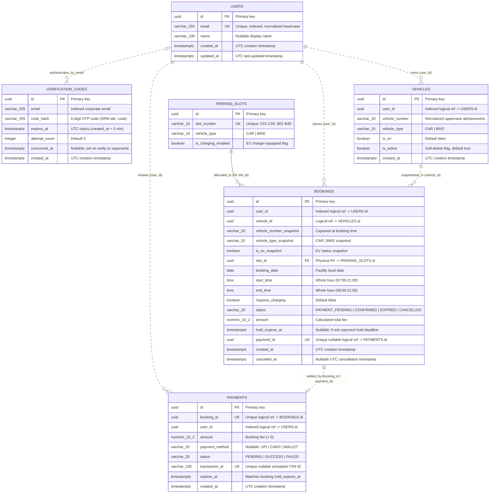

# Entity-Relationship (ER) & Database Design

## 1. Database Topology Overview

The platform enforces strict **Database-per-Service** isolation across four PostgreSQL databases (`user_db`, `vehicle_db`, `parking_db`, `payment_db`).

* **Physical Foreign Keys** exist **only** within the same database (`bookings.slot_id -> parking_slots.id` inside `parking_db`).
* **Cross-Service References** (`user_id`, `vehicle_id`, `booking_id`, `payment_id`) are stored as plain `UUID` columns without cross-database foreign keys, validated via authenticated REST calls and preserved historically via immutable snapshot columns.

---

## 2. Unified System Entity-Relationship Diagram

Solid relationships (`||--o{`) represent **physical database foreign keys** enforced by PostgreSQL. Dashed relationships (`||..o{`, `||..o|`) represent **logical cross-service UUID references** across isolated microservice databases.

---

## 3. Database-by-Database Schema Specification

### 3.1 `user_db` — User & Auth Service (`user_auth_user`)

#### Table: `users`
| Column | PostgreSQL Type | Nullable | Default | Constraints / Indexes |
| :--- | :--- | :---: | :--- | :--- |
| `id` | `UUID` | `NO` | `uuid4()` | `PRIMARY KEY` |
| `email` | `VARCHAR(255)` | `NO` | — | `UNIQUE`, `INDEX` (`ix_users_email`) |
| `name` | `VARCHAR(100)` | `YES` | `NULL` | — |
| `created_at` | `TIMESTAMPTZ` | `NO` | `utcnow()` | — |
| `updated_at` | `TIMESTAMPTZ` | `NO` | `utcnow()` | Auto-updated via `onupdate=utcnow` |

#### Table: `verification_codes`
| Column | PostgreSQL Type | Nullable | Default | Constraints / Indexes |
| :--- | :--- | :---: | :--- | :--- |
| `id` | `UUID` | `NO` | `uuid4()` | `PRIMARY KEY` |
| `email` | `VARCHAR(255)` | `NO` | — | `INDEX` (`ix_verification_codes_email`); intentionally decoupled from `users.id` so OTPs work prior to first-time user creation |
| `code_hash` | `VARCHAR(255)` | `NO` | — | Mapped to ORM attribute `VerificationCode.code` |
| `expires_at` | `TIMESTAMPTZ` | `NO` | — | `created_at + 5 minutes` |
| `attempt_count` | `INTEGER` | `NO` | `0` | Tracks verification attempts |
| `consumed_at` | `TIMESTAMPTZ` | `YES` | `NULL` | Populated upon verification or when superseded by a newer OTP |
| `created_at` | `TIMESTAMPTZ` | `NO` | `utcnow()` | Ordered `DESC` during verification lookup |

---

### 3.2 `vehicle_db` — Vehicle Service (`vehicle_user`)

#### Table: `vehicles`
| Column | PostgreSQL Type | Nullable | Default | Constraints / Indexes |
| :--- | :--- | :---: | :--- | :--- |
| `id` | `UUID` | `NO` | `uuid4()` | `PRIMARY KEY` |
| `user_id` | `UUID` | `NO` | — | `INDEX` (`ix_vehicles_user_id`); logical reference to `users.id` |
| `vehicle_number` | `VARCHAR(20)` | `NO` | — | Normalized (`^[A-Z0-9]{4,20}$`); active uniqueness per user enforced in service logic |
| `vehicle_type` | `VARCHAR(10)` | `NO` | — | Domain values: `CAR`, `BIKE` |
| `is_ev` | `BOOLEAN` | `NO` | `false` | Determines EV charging eligibility |
| `is_active` | `BOOLEAN` | `NO` | `true` | Soft-delete flag; preserves historical booking references and permits plate re-registration |
| `created_at` | `TIMESTAMPTZ` | `NO` | `utcnow()` | — |

---

### 3.3 `parking_db` — Parking Service (`parking_user`)

#### Table: `parking_slots`
| Column | PostgreSQL Type | Nullable | Default | Constraints / Indexes |
| :--- | :--- | :---: | :--- | :--- |
| `id` | `UUID` | `NO` | `uuid4()` | `PRIMARY KEY` |
| `slot_number` | `VARCHAR(10)` | `NO` | — | `UNIQUE` (`C01`–`C60`, `B01`–`B40`) |
| `vehicle_type` | `VARCHAR(10)` | `NO` | — | `CAR` or `BIKE` |
| `is_charging_enabled` | `BOOLEAN` | `NO` | `false` | `true` for `C51`–`C60` and `B36`–`B40` |

**Seeded Slot Distribution (100 Total Slots):**
* `C01`–`C50` (50 slots): `CAR`, `is_charging_enabled = false`
* `C51`–`C60` (10 slots): `CAR`, `is_charging_enabled = true`
* `B01`–`B35` (35 slots): `BIKE`, `is_charging_enabled = false`
* `B36`–`B40` (5 slots): `BIKE`, `is_charging_enabled = true`

#### Table: `bookings`
| Column | PostgreSQL Type | Nullable | Default | Constraints / Indexes |
| :--- | :--- | :---: | :--- | :--- |
| `id` | `UUID` | `NO` | `uuid4()` | `PRIMARY KEY` |
| `user_id` | `UUID` | `NO` | — | `INDEX` (`ix_bookings_user_id`); logical reference to `users.id` |
| `vehicle_id` | `UUID` | `NO` | — | Logical reference to `vehicles.id` |
| `vehicle_number_snapshot` | `VARCHAR(20)` | `NO` | — | Denormalized snapshot at booking time |
| `vehicle_type_snapshot` | `VARCHAR(10)` | `NO` | — | Denormalized snapshot (`CAR` / `BIKE`) |
| `is_ev_snapshot` | `BOOLEAN` | `NO` | — | Denormalized snapshot |
| `slot_id` | `UUID` | `NO` | — | `FOREIGN KEY REFERENCES parking_slots(id)` |
| `booking_date` | `DATE` | `NO` | — | Facility local date (`Asia/Kolkata`) |
| `start_time` | `TIME` | `NO` | — | Whole hour (`07:00`–`21:00`) |
| `end_time` | `TIME` | `NO` | — | Whole hour (`08:00`–`22:00`) |
| `requires_charging` | `BOOLEAN` | `NO` | `false` | Determines slot pool & hourly rate |
| `status` | `VARCHAR(20)` | `NO` | `'PAYMENT_PENDING'` | `PAYMENT_PENDING`, `CONFIRMED`, `EXPIRED`, `CANCELLED` |
| `amount` | `NUMERIC(10, 2)` | `NO` | — | `hours * rate_per_hour` |
| `hold_expires_at` | `TIMESTAMPTZ` | `YES` | `NULL` | `created_at + 5 minutes` |
| `payment_id` | `UUID` | `YES` | `NULL` | `UNIQUE`; logical reference to `payments.id` |
| `created_at` | `TIMESTAMPTZ` | `NO` | `utcnow()` | — |
| `cancelled_at` | `TIMESTAMPTZ` | `YES` | `NULL` | Populated on user cancellation |

---

### 3.4 `payment_db` — Payment Service (`payment_user`)

#### Table: `payments`
| Column | PostgreSQL Type | Nullable | Default | Constraints / Indexes |
| :--- | :--- | :---: | :--- | :--- |
| `id` | `UUID` | `NO` | `uuid4()` | `PRIMARY KEY` |
| `booking_id` | `UUID` | `NO` | — | `UNIQUE` (enforces 1-to-1 idempotent payment per booking) |
| `user_id` | `UUID` | `NO` | — | `INDEX` (`ix_payments_user_id`); logical reference to `users.id` |
| `amount` | `NUMERIC(10, 2)` | `NO` | — | Positive decimal amount |
| `payment_method` | `VARCHAR(20)` | `YES` | `NULL` | Populated on process: `UPI`, `CARD`, `WALLET` |
| `status` | `VARCHAR(20)` | `NO` | `'PENDING'` | `PENDING`, `SUCCESS`, `FAILED` |
| `transaction_id` | `VARCHAR(100)` | `YES` | `NULL` | `UNIQUE`; `TXN<10-hex>` on `SUCCESS`, `NULL` on `FAILED` |
| `expires_at` | `TIMESTAMPTZ` | `NO` | — | Synchronized with `bookings.hold_expires_at` |
| `created_at` | `TIMESTAMPTZ` | `NO` | `utcnow()` | — |

---

## 4. Database Security & Schema Governance

1. **Role & Privilege Isolation (`scripts/init_postgres.sql`)**:
   * `REVOKE CONNECT ON DATABASE <db> FROM PUBLIC` blocks unauthorized cross-service connections at the PostgreSQL authentication layer.
   * Each service role owns only its respective database and `public` schema (`ALTER SCHEMA public OWNER TO <role>`).
2. **Schema Lifecycle & Migrations**:
   * Local development boots cleanly via idempotent `Base.metadata.create_all()` + automatic slot seeding (`seed_default_slots`).
   * Versioned schema evolution is demonstrated in `services/parking-service/alembic/` using **Alembic** migrations.
