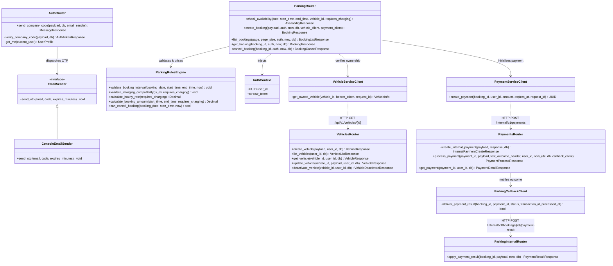
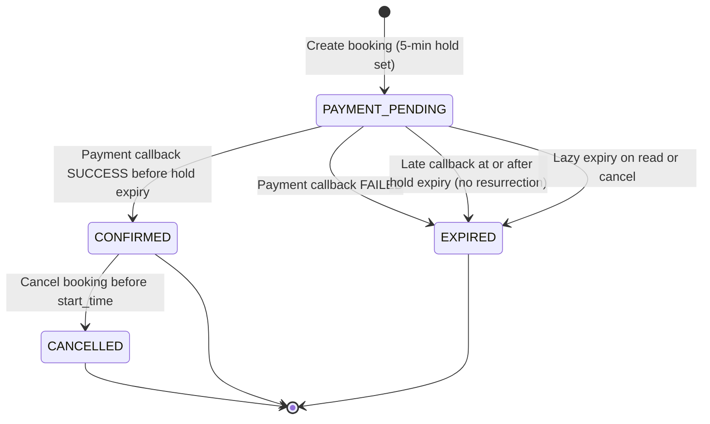
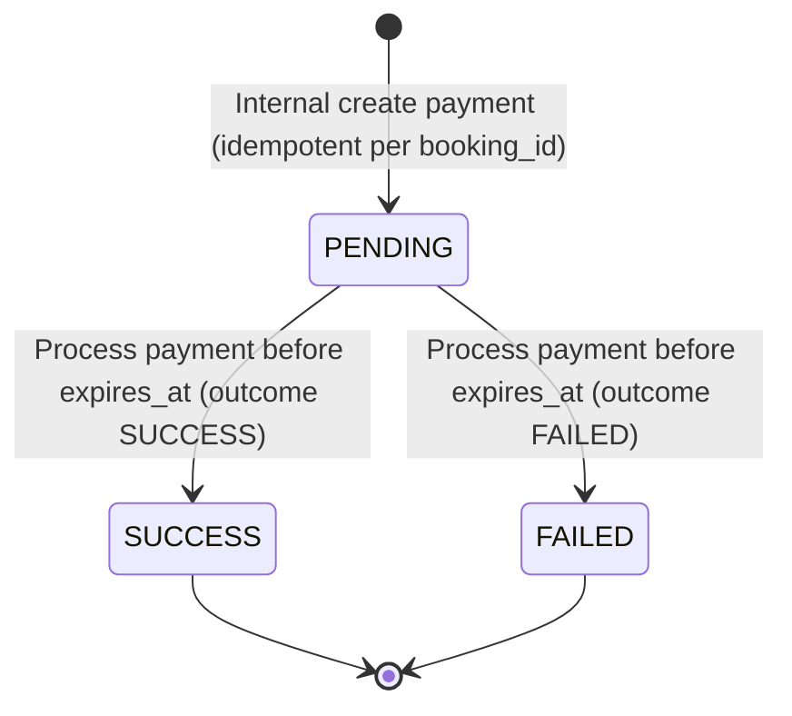
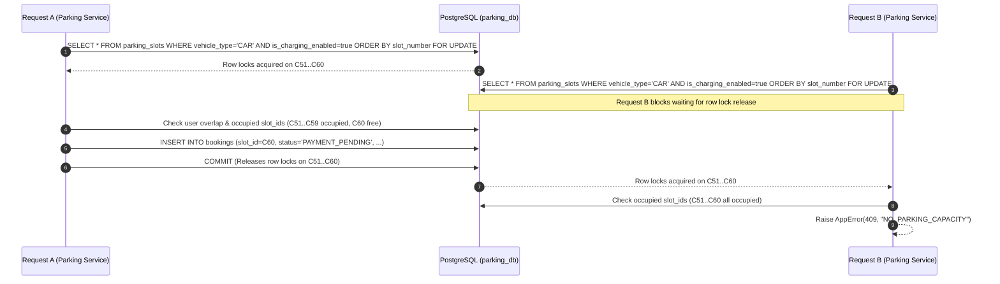

# Low-Level Design (LLD)

## 1. Internal Service Layered Structure

Every microservice follows a uniform four-layer internal structure inside `services/<service-name>/app/`:

```text
app/
├── main.py              # FastAPI app factory, lifespan DB init/seeding, exception registration, /health
├── api/
│   ├── v1/              # Public versioned REST routers (Bearer JWT protected)
│   └── internal.py      # Internal M2M endpoints (X-Internal-Service-Token protected)
├── core/
│   ├── config.py        # Pydantic BaseSettings (.env + defaults)
│   ├── database.py      # SQLAlchemy 2.0 Engine, SessionLocal, Base, get_db dependency
│   ├── security.py      # JWT encode/decode, HTTPBearer dependencies, M2M token guards
│   ├── clock.py         # Injectable UTC & business timezone (Asia/Kolkata) clock helpers
│   └── errors.py        # AppError exception + standardized JSON error envelope handlers
├── models/              # SQLAlchemy 2.0 typed ORM entities (Mapped / mapped_column)
├── schemas/             # Pydantic v2 request/response DTOs & field validators
└── services/            # Domain rules, email dispatchers, and httpx inter-service clients
```

---

## 2. Core Component & Class Diagram



---

## 3. Domain State Machines

### 3.1 Booking State Machine (`parking-service`)



**Critical State Invariants:**
* **No Resurrection (`EXPIRED_NO_RESURRECTION`)**: Once `hold_expires_at <= now_utc`, the slot is immediately eligible for allocation to other employees. Even if a delayed `SUCCESS` callback arrives afterward, `apply_payment_result()` transitions the booking to `EXPIRED` rather than `CONFIRMED`, preventing double-occupancy.
* **Strict Cancellation Gate**: Only `CONFIRMED` bookings whose `start_time` is still in the future (evaluated in `Asia/Kolkata`) can transition to `CANCELLED`.

### 3.2 Payment State Machine (`payment-service`)



---

## 4. Core Low-Level Algorithms & Concurrency Design

### 4.1 Concurrency-Safe Slot Allocation (`SELECT ... FOR UPDATE`)

When two requests race for the last compatible slot (e.g., `C51`), `create_booking()` serializes slot selection at the database row level:



### 4.2 Half-Open Time-Interval Overlap Formula

Two time intervals `[start_time, end_time)` and `[req_start, req_end)` overlap if and only if:

$$\text{Booking.start\_time} < \text{req\_end} \quad \land \quad \text{Booking.end\_time} > \text{req\_start}$$

* **Adjacent Bookings Allowed**: Existing `09:00–11:00` and requested `11:00–13:00` evaluate `09:00 < 13:00 (True)` and `11:00 > 11:00 (False)` $\rightarrow$ **No overlap**.
* **Partial/Full Overlap Blocked**: Existing `09:00–11:00` and requested `10:00–12:00` evaluate `09:00 < 12:00 (True)` and `11:00 > 10:00 (True)` $\rightarrow$ **Overlap detected**.

### 4.3 Zero-Cron Lazy Hold Expiry

Instead of running a separate background scheduler process to sweep expired holds:
1. **Real-Time Availability Predicate (`_active_booking_filter`)**:
   ```python
   or_(
       Booking.status == "CONFIRMED",
       and_(Booking.status == "PAYMENT_PENDING", Booking.hold_expires_at > now_utc),
   )
   ```
   The instant `now_utc >= hold_expires_at`, an unpaid hold stops blocking slot availability and user-overlap queries.
2. **Read/Write Materialization (`_expire_stale_holds`)**:
   Whenever bookings are fetched (`GET /bookings`, `GET /bookings/{id}`) or cancelled (`POST /bookings/{id}/cancel`), stale `PAYMENT_PENDING` rows are persisted as `status = "EXPIRED"`.

### 4.4 Business Rules & Pricing Specification (`rules.py`)

| Rule | Condition Enforced | Failure Code |
| :--- | :--- | :--- |
| **Facility Timezone** | All dates/hours evaluated in `Asia/Kolkata` (`ZoneInfo`) | — |
| **Booking Horizon** | `booking_date` must be `today` or `tomorrow` | `422 BOOKING_WINDOW_VIOLATION` |
| **Sunday Closure** | `booking_date.weekday() != 6` | `422 BOOKING_WINDOW_VIOLATION` |
| **Whole-Hour Alignment** | `minute == 0` and `second == 0` on both `start_time` and `end_time` | `422 INVALID_BOOKING_TIME` |
| **Operating Hours** | `07:00 <= start_time < end_time <= 22:00` | `422 INVALID_BOOKING_TIME` |
| **Max Duration** | `end_time.hour - start_time.hour <= 12` | `422 INVALID_BOOKING_TIME` |
| **Future Start** | `datetime.combine(booking_date, start_time, tz) > now_local` | `422 INVALID_BOOKING_TIME` |
| **EV Compatibility** | `requires_charging == True` requires `vehicle.is_ev == True` | `422 CHARGING_NOT_SUPPORTED` |
| **Pricing Formula** | Normal slot: `10.00 * hours`; EV charging slot: `20.00 * hours` | — |

---

## 5. Security, Resilience & Error Handling Design

### 5.1 Authentication & Authorization Pipeline
* **OTP Security**: `secrets.randbelow(1_000_000)` CSPRNG generation; requesting a new code marks all prior unconsumed codes for that email as `consumed_at = now`; successful verification sets `consumed_at = now` to block replay attacks.
* **JWT Structure**: HS256-signed payload `{"sub": "<user_uuid>", "iat": <epoch>, "exp": <epoch>}` with 60-minute TTL.
* **IDOR Prevention**: Every entity query in `vehicle-service`, `parking-service`, and `payment-service` scopes `WHERE user_id = :authenticated_user_id`, returning `404` on foreign UUIDs so resource existence is never leaked.

### 5.2 Inter-Service Timeout & Idempotency Design
* **Bounded HTTP Timeouts**: All `httpx.Client(timeout=3.0)` calls fail fast and map network failures to `503 VEHICLE_SERVICE_UNAVAILABLE` or `503 PAYMENT_SERVICE_UNAVAILABLE`.
* **Idempotent Internal Endpoints**:
  * `POST /internal/v1/payments` returns `200 OK` with the existing payment if retried with matching `(booking_id, user_id, amount)`, or `409 PAYMENT_REQUEST_CONFLICT` if tampered.
  * `POST /internal/v1/bookings/{id}/payment-result` returns `200 OK` (`ALREADY_APPLIED`) if a `CONFIRMED` callback is delivered twice.

### 5.3 Standardized Error Envelope
All four services register identical `AppError`, `RequestValidationError`, `HTTPException`, and catch-all `Exception` handlers returning a consistent JSON contract:

```json
{
  "error": {
    "code": "NO_PARKING_CAPACITY",
    "message": "No compatible parking slot is available for the requested interval.",
    "request_id": "c7a6e920-4f1b-4d8e-9b2a-81f0e319c401"
  }
}
```
