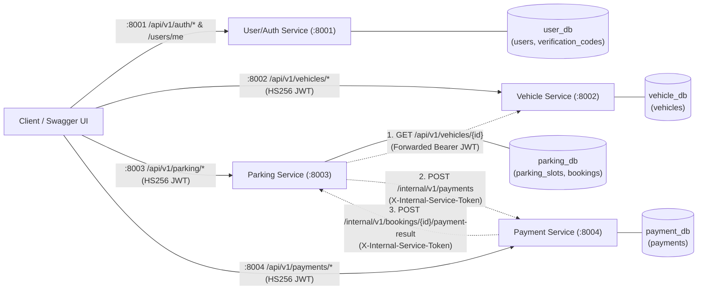
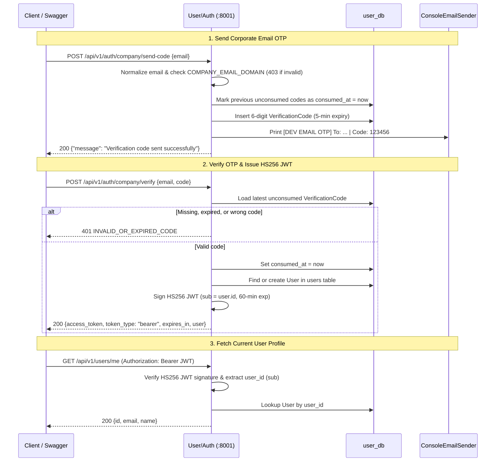
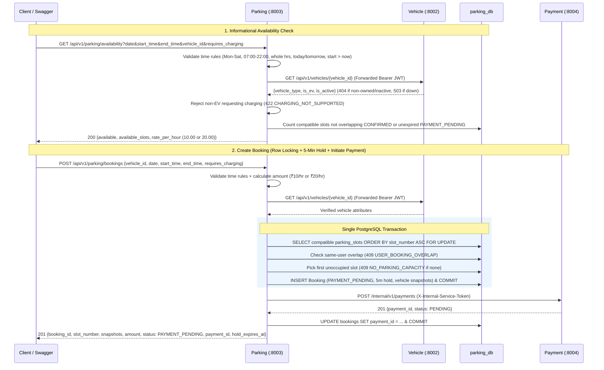
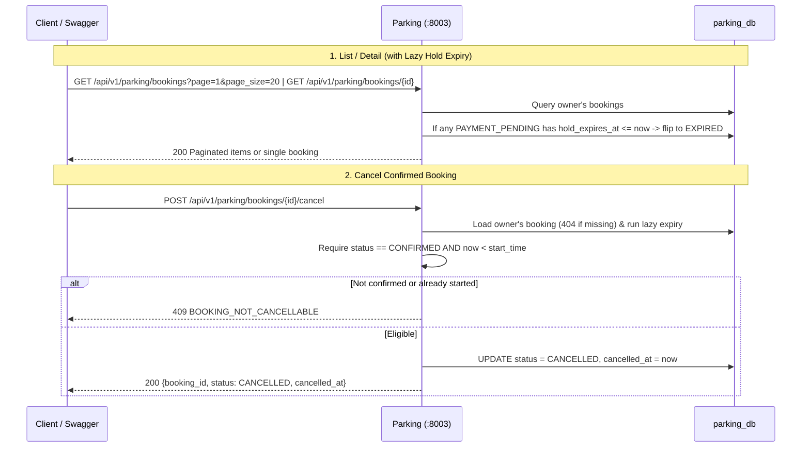
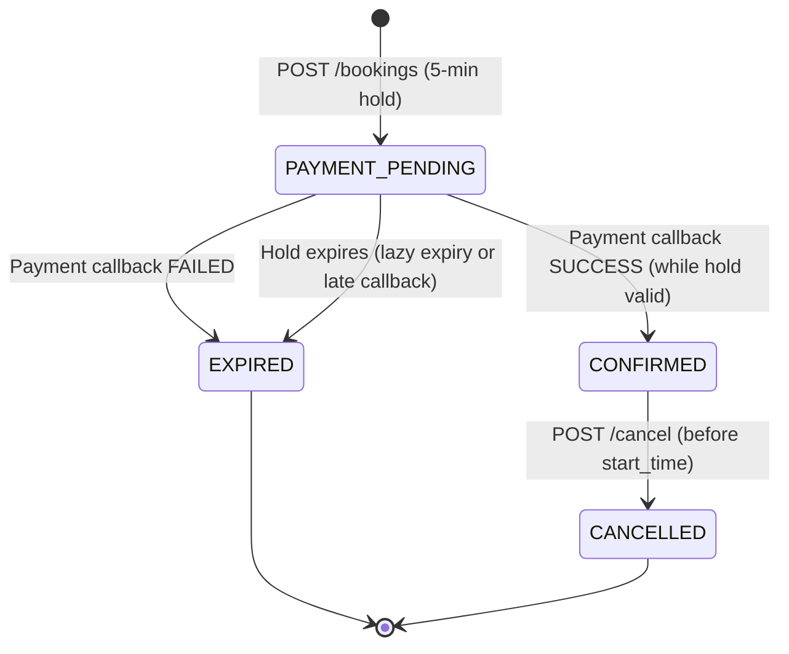
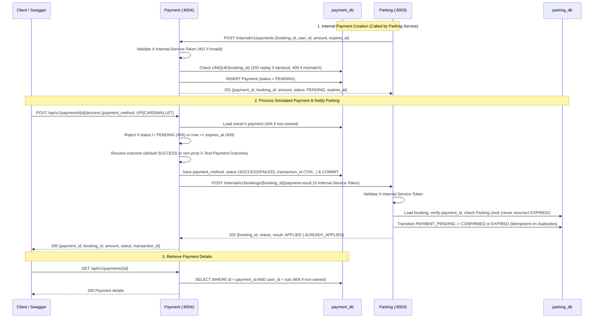
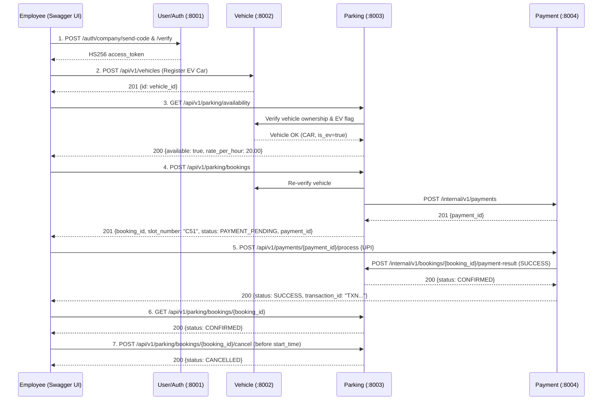

# Corporate Parking Reservation System — API Flow Diagrams

Visual guide to all **17 APIs** across the **4 Microservices** (`8001`–`8004`), showing the exact request/response flow, database writes, JWT validation, and inter-service HTTP calls (`httpx`).

---

## 1. System Architecture Overview

Each microservice runs independently with its own Swagger UI (`/docs`) and isolated PostgreSQL database (`user_db`, `vehicle_db`, `parking_db`, `payment_db`).



---

## 2. User/Auth Service (`services/user-auth-service` — Port `8001`, 3 APIs)

Authentication is corporate-email OTP based (`COMPANY_EMAIL_DOMAIN`) issuing stateless **HS256 JWT** access tokens.



---

## 3. Vehicle Service (`services/vehicle-service` — Port `8002`, 5 APIs)

Standalone owner-scoped CRUD service on `vehicle_db`. All 5 endpoints verify the HS256 Bearer JWT locally.

```mermaid
sequenceDiagram
    participant C as Client / Swagger
    participant V as Vehicle (:8002)
    participant VDB as vehicle_db

    Note over C,VDB: 1. Register Vehicle
    C->>V: POST /api/v1/vehicles {vehicle_number, vehicle_type, is_ev}
    V->>V: Validate HS256 JWT & normalize plate ("mh 12-ab 1234" -> "MH12AB1234")
    V->>VDB: Check duplicate active plate for user_id (409 if exists)
    V->>VDB: Insert Vehicle (is_active = true)
    V-->>C: 201 {id, vehicle_number, vehicle_type, is_ev, is_active: true}

    Note over C,VDB: 2. List & Get Active Vehicles (Owner-Scoped)
    C->>V: GET /api/v1/vehicles  |  GET /api/v1/vehicles/{id}
    V->>VDB: Query WHERE user_id = sub AND is_active = true (404 if non-owned/inactive)
    V-->>C: 200 Vehicle list or single vehicle

    Note over C,VDB: 3. Update & Soft-Deactivate Vehicle
    C->>V: PUT /api/v1/vehicles/{id} {vehicle_number, vehicle_type, is_ev}
    V->>VDB: Verify owner & active status; check duplicate plate; update & commit
    V-->>C: 200 Updated vehicle

    C->>V: DELETE /api/v1/vehicles/{id}
    V->>VDB: Verify owner & active status; set is_active = false
    V-->>C: 200 {id, is_active: false, message: "Vehicle removed successfully"}
```

---

## 4. Parking Service (`services/parking-service` — Port `8003`, 5 Public + 1 Internal API)

### 4.1 Availability & Atomic Booking Creation (`SELECT ... FOR UPDATE` + 5-Min Hold)



### 4.2 Booking History, Lazy Hold Expiry & Cancellation



### 4.3 Booking State Machine



---

## 5. Payment Service (`services/payment-service` — Port `8004`, 1 Internal + 2 Public APIs)



---

## 6. Complete End-to-End User Journey (All 4 Microservices)


