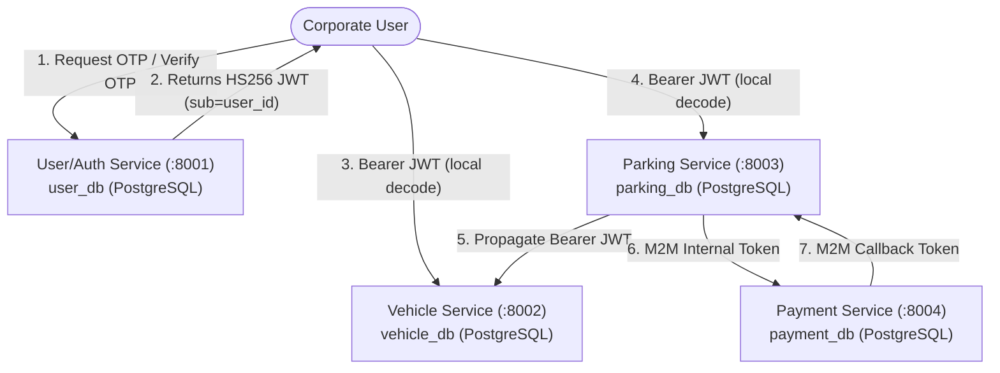
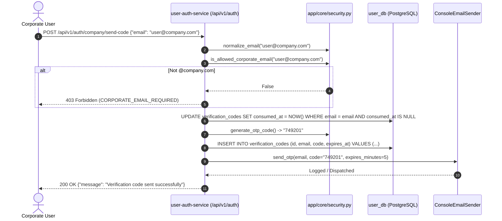
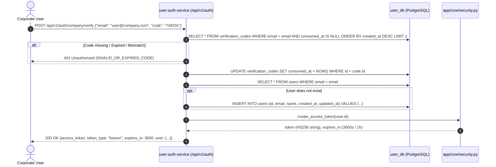
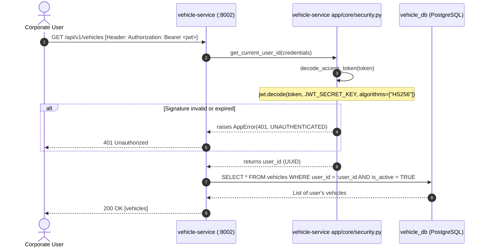
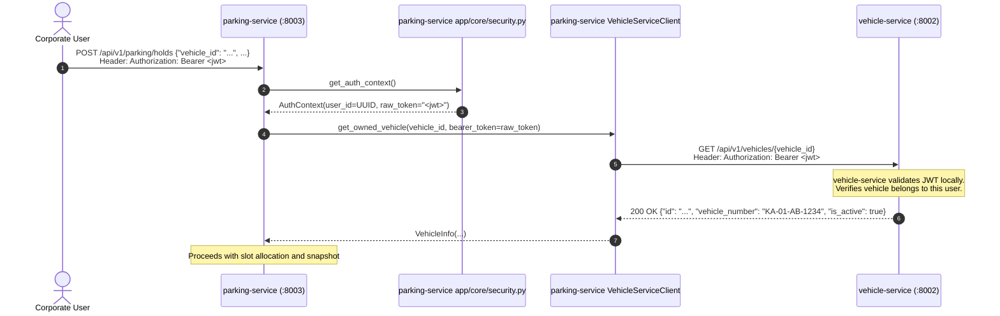
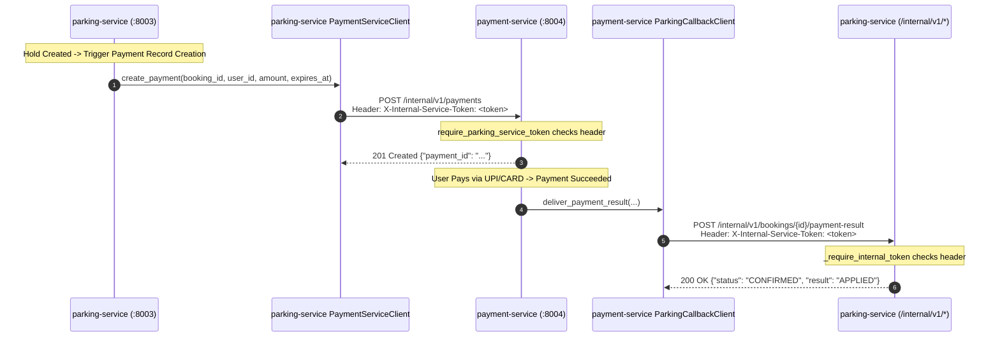

# Authentication Architecture & Pipeline Flow Guide

> **System**: Corporate Parking Simplified Microservices Platform  
> **Protocol**: Corporate Email OTP + Stateless HS256 Bearer JWT + Inter-Service Shared Secrets  
> **Scope**: `user-auth-service`, `vehicle-service`, `parking-service`, `payment-service`

---

## 1. Executive Architecture Overview

In this microservice architecture, authentication and authorization are built around three core principles:
1. **Passwordless Corporate Email OTP**: Users never manage or leak passwords. Login requires verifying a 6-digit one-time passcode delivered strictly to an authorized corporate email domain (`@company.com`).
2. **Stateless HS256 JWT (Zero-Database-Lookup Verification)**: Once the User/Auth Service mints a JWT, downstream microservices (`vehicle-service`, `parking-service`, `payment-service`) verify signatures and extract the caller's `user_id` **locally** using a shared secret (`JWT_SECRET_KEY`). Downstream services do **not** query `user_db` or make HTTP calls back to `user-auth-service` for token verification.
3. **Machine-to-Machine (M2M) Internal Authentication**: Internal administrative and callback endpoints (`/internal/v1/*`) are isolated from public users and authenticated using a dedicated HTTP header: `X-Internal-Service-Token`.



---

## 2. Authentication Pipeline Map: Files & Functions

| Pipeline Stage | Service & File Path | Functions / Classes | Responsibility |
| :--- | :--- | :--- | :--- |
| **Domain & Email Validation** | [security.py](file:///c:/Users/skamalud/OneDrive%20-%20Capgemini/Documents/ParkingSimplified/services/user-auth-service/app/core/security.py) | `normalize_email()`, `is_allowed_corporate_email()` | Trims/lowercases email; enforces `@company.com` whitelist domain. |
| **CSPRNG OTP Generation** | [security.py](file:///c:/Users/skamalud/OneDrive%20-%20Capgemini/Documents/ParkingSimplified/services/user-auth-service/app/core/security.py) | `generate_otp_code()` | Cryptographically secure 6-digit code generation using `secrets.randbelow(1_000_000)`. |
| **OTP Dispatch & Persistence** | [auth.py (API)](file:///c:/Users/skamalud/OneDrive%20-%20Capgemini/Documents/ParkingSimplified/services/user-auth-service/app/api/v1/auth.py)<br>[email_sender.py](file:///c:/Users/skamalud/OneDrive%20-%20Capgemini/Documents/ParkingSimplified/services/user-auth-service/app/services/email_sender.py) | `send_company_code()`<br>`ConsoleEmailSender.send_otp()` | Invalidates previous unconsumed codes, persists new `VerificationCode` (expires in 5 min), dispatches OTP. |
| **OTP Verification & User Upsert** | [auth.py (API)](file:///c:/Users/skamalud/OneDrive%20-%20Capgemini/Documents/ParkingSimplified/services/user-auth-service/app/api/v1/auth.py) | `verify_company_code()` | Verifies latest unconsumed OTP against expiry; sets `consumed_at = now`; auto-provisions `User` record if new. |
| **JWT Token Minting** | [security.py](file:///c:/Users/skamalud/OneDrive%20-%20Capgemini/Documents/ParkingSimplified/services/user-auth-service/app/core/security.py) | `create_access_token()` | Packages claims (`sub`, `iat`, `exp`), signs with HS256 and `JWT_SECRET_KEY`. |
| **Auth Service Profile Check** | [auth.py (API)](file:///c:/Users/skamalud/OneDrive%20-%20Capgemini/Documents/ParkingSimplified/services/user-auth-service/app/api/v1/auth.py)<br>[security.py](file:///c:/Users/skamalud/OneDrive%20-%20Capgemini/Documents/ParkingSimplified/services/user-auth-service/app/core/security.py) | `get_me()`<br>`get_current_user()` | Decodes Bearer token and fetches current user entity from `user_db`. |
| **Vehicle Service Local Auth** | [security.py](file:///c:/Users/skamalud/OneDrive%20-%20Capgemini/Documents/ParkingSimplified/services/vehicle-service/app/core/security.py) | `decode_access_token()`<br>`get_current_user_id()` | Extracts user UUID from Bearer token without DB calls; enforces tenant isolation on vehicles. |
| **Parking Service Local Auth** | [security.py](file:///c:/Users/skamalud/OneDrive%20-%20Capgemini/Documents/ParkingSimplified/services/parking-service/app/core/security.py) | `get_auth_context()`<br>`AuthContext` | Extracts user UUID and retains raw Bearer token for downstream forwarding to Vehicle Service. |
| **Payment Service Local Auth** | [security.py](file:///c:/Users/skamalud/OneDrive%20-%20Capgemini/Documents/ParkingSimplified/services/payment-service/app/core/security.py) | `get_current_user_id()` | Authenticates user paying or checking payment status for payment ownership verification. |
| **M2M Inter-Service Security** | [clients.py](file:///c:/Users/skamalud/OneDrive%20-%20Capgemini/Documents/ParkingSimplified/services/parking-service/app/services/clients.py)<br>[internal.py](file:///c:/Users/skamalud/OneDrive%20-%20Capgemini/Documents/ParkingSimplified/services/parking-service/app/api/internal.py)<br>[parking_callback.py](file:///c:/Users/skamalud/OneDrive%20-%20Capgemini/Documents/ParkingSimplified/services/payment-service/app/services/parking_callback.py) | `_require_internal_token()`<br>`require_parking_service_token()` | Validates `X-Internal-Service-Token` header on `/internal/v1/*` endpoints. |

---

## 3. End-to-End Flow Walkthrough

### Phase 1: Requesting the Corporate OTP



#### Detailed Code Mechanics:
1. **Email Normalization & Whitelisting**:
   - `normalize_email()` strips whitespace and lowercases string.
   - `is_allowed_corporate_email()` verifies `email.rsplit("@", 1)[1] == settings.COMPANY_EMAIL_DOMAIN` (`company.com`). If not, it raises `AppError(403, "CORPORATE_EMAIL_REQUIRED", "Only corporate email addresses are allowed.")`.
2. **Invalidating Stale Codes**:
   - To prevent multiple active codes for the same user, any existing code where `consumed_at IS NULL` has `consumed_at` set to the current UTC timestamp.
3. **CSPRNG Code Generation**:
   - `generate_otp_code()` calls Python's cryptographically secure `secrets.randbelow(1_000_000)` and formats it as a zero-padded 6-digit string (`f"{...:06d}"`).
4. **Database Record**:
   - Saved in table `verification_codes` with `expires_at = now + 5 minutes`.
5. **Console Email Dispatch**:
   - In development/testing, `ConsoleEmailSender.send_otp()` prints the code directly to standard out (`stdout`), making testing instantaneous without relying on external third-party email gateways.

---

### Phase 2: Verifying OTP & Minting JWT



#### Detailed Code Mechanics:
1. **Verification Queries & Replay Protection**:
   - `verify_company_code()` fetches the latest unconsumed code for the email.
   - It checks:
     - Is there an unconsumed record?
     - Has `expires_at` passed? (`_as_utc(verification.expires_at) <= now`)
     - Does the OTP string match? (`verification.code != payload.code`)
   - If any check fails, it immediately returns `401 INVALID_OR_EXPIRED_CODE`.
   - Once verified, `verification.consumed_at = now` is committed immediately, making OTP reuse impossible.
2. **Automatic Provisioning (JIT User Provisioning)**:
   - If no record exists in `users` table for this email, a new `User(id=uuid.uuid4(), email=email, name=None)` is created.
3. **Token Creation (`create_access_token`)**:
   - Payload claims:
     - `sub`: `str(user.id)` (standard JWT Subject claim holding user UUID)
     - `iat`: issued-at epoch timestamp in UTC
     - `exp`: expiration timestamp (`iat + settings.ACCESS_TOKEN_EXPIRE_MINUTES * 60`, default 240 mins)
   - Signed using `jwt.encode(payload, settings.JWT_SECRET_KEY, algorithm="HS256")`.

---

### Phase 3: Token Verification in Downstream Services (Zero DB Lookups)

When the user calls any downstream API (e.g. `POST /api/v1/vehicles` or `POST /api/v1/parking/holds`), the token is validated locally without contacting `user-auth-service`.



#### Why This Is an Enterprise Best Practice:
1. **High Performance**: No network hop from `vehicle-service` to `user-auth-service` on every request.
2. **Resilience**: Even if `user-auth-service` experiences downtime or restarts, existing authenticated users can continue registering vehicles, booking slots, and making payments until token expiry.
3. **Tenant Isolation**: By extracting `user_id` strictly from the signed cryptographic token, users can only access or modify records where `user_id == current_user_id`.

---

### Phase 4: Token Propagation in Distributed Operations

When booking a parking slot, `parking-service` needs to verify vehicle ownership with `vehicle-service`.



#### Detailed Code Mechanics:
- In `services/parking-service/app/core/security.py`, `get_auth_context()` extracts both:
  - `user_id`: decoded `uuid.UUID`
  - `raw_token`: the original string from `credentials.credentials`
- `VehicleServiceClient` passes `headers={"Authorization": f"Bearer {bearer_token}"}`.
- If an attacker attempts to hold a slot using another employee's vehicle ID, `vehicle-service` rejects the call with `404 VEHICLE_NOT_FOUND` because the vehicle does not belong to the token's `user_id`.

---

### Phase 5: Machine-to-Machine (M2M) Internal Authentication

Internal inter-service operations do not represent an end-user action; they represent asynchronous background orchestration between services.



#### Detailed Code Mechanics:
- Protected Endpoints:
  - `POST /internal/v1/payments` on Payment Service
  - `POST /internal/v1/bookings/{booking_id}/payment-result` on Parking Service
- Security Check:
  ```python
  def _require_internal_token(
      token: str | None = Header(default=None, alias="X-Internal-Service-Token"),
  ) -> None:
      if not token or token != settings.INTERNAL_SERVICE_TOKEN:
          raise AppError(401, "INTERNAL_CALLER_UNAUTHORIZED", "Invalid internal service token.")
  ```
- Any request without this secret header is immediately rejected with HTTP `401 INTERNAL_CALLER_UNAUTHORIZED`.

---

## 4. Security Controls & Error Reference

| Scenario | HTTP Status | Error Code | Description / Remedy |
| :--- | :---: | :--- | :--- |
| Non-corporate email submitted | `403` | `CORPORATE_EMAIL_REQUIRED` | Only addresses ending in `@company.com` are accepted. |
| Code incorrect or expired | `401` | `INVALID_OR_EXPIRED_CODE` | Code does not match database record or 5-minute validity window elapsed. |
| Reused OTP code | `401` | `INVALID_OR_EXPIRED_CODE` | Upon first successful verification, `consumed_at` is set, blocking replay attacks. |
| Missing `Authorization` header | `401` | `UNAUTHENTICATED` | `Authorization: Bearer <token>` was not passed. |
| Malformed or expired JWT | `401` | `UNAUTHENTICATED` | Token signature failed validation or token timestamp expired. |
| Vehicle does not belong to caller | `404` | `VEHICLE_NOT_FOUND` | `vehicle-service` restricts queries to caller's `user_id`. |
| Missing or wrong internal token | `401` | `INTERNAL_CALLER_UNAUTHORIZED` | Endpoint `/internal/v1/*` called without matching `X-Internal-Service-Token`. |

---

## 5. Configuration & Environment Variables

All microservices share standardized configuration keys for authentication across their `.env` / `settings` objects:

```ini
# User & Auth Service
COMPANY_EMAIL_DOMAIN=company.com
OTP_EXPIRE_MINUTES=5
ACCESS_TOKEN_EXPIRE_MINUTES=60
JWT_SECRET_KEY=super-secret-jwt-key-for-corporate-parking
JWT_ALGORITHM=HS256

# Vehicle Service, Parking Service, Payment Service
JWT_SECRET_KEY=super-secret-jwt-key-for-corporate-parking
JWT_ALGORITHM=HS256
INTERNAL_SERVICE_TOKEN=dev-internal-service-token
```

---

## 6. Testing & Verifying the Pipeline

To execute the automated authentication test suite:
```powershell
.\.venv\Scripts\pytest.exe services\user-auth-service\tests\test_auth.py -v
```

### What `test_auth.py` Verifies:
1. **`test_health`**: Verifies `/health` returns `200 OK` with `"service": "user-auth-service"`.
2. **`test_reject_non_corporate_email`**: Asserts that `outsider@gmail.com` is rejected with `403 CORPORATE_EMAIL_REQUIRED`.
3. **`test_company_otp_login_and_me_flow`**: Asserts OTP generation and email normalization (`Alice@Company.com` -> `alice@company.com`), wrong OTP rejection (`401 INVALID_OR_EXPIRED_CODE`), valid OTP verification, HS256 JWT token generation, replay protection (`401` on second use of the same OTP), and `/api/v1/users/me` resolution with `Authorization: Bearer <token>`.

To run end-to-end multi-service authentication and authorization:
```powershell
.\.venv\Scripts\pytest.exe tests\test_e2e_journey.py -v
```
This verifies OTP generation, token minting, token usage in vehicle registration, slot holding with token propagation, and inter-service payment confirmation.
