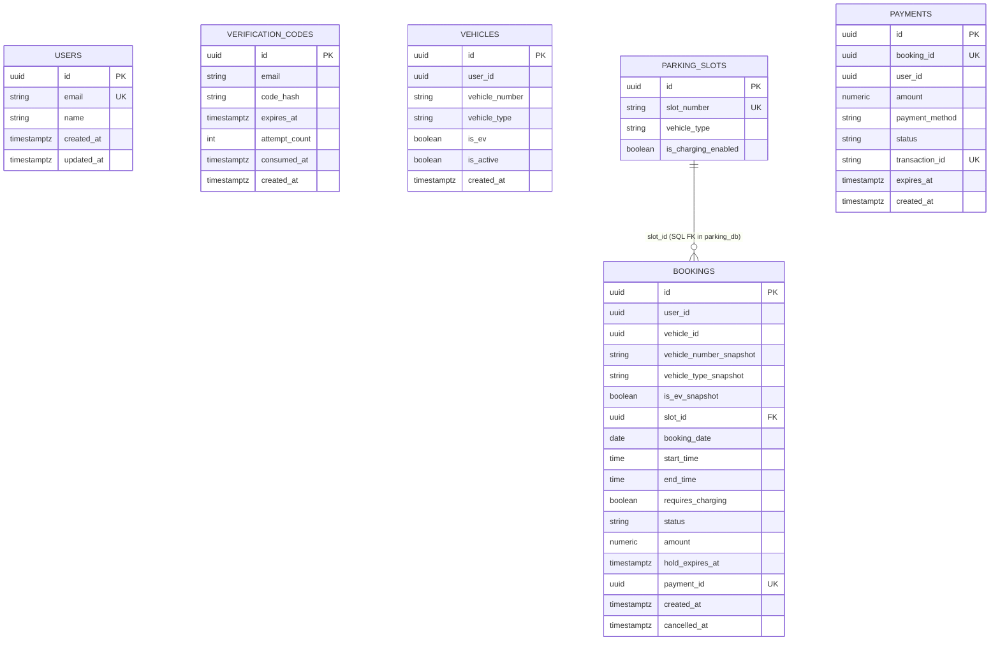

# Database & Persistence Implementation Guide (Project-Specific)

A focused guide explaining **every database, table, relationship, SQLAlchemy setup, Alembic migration, locking query, and testing strategy** implemented in `ParkingSimplified`.

---

## 1. Database Topology & Isolation (`scripts/init_postgres.sql`)

This project implements the **Database-per-Service** microservice pattern on a single PostgreSQL server using **4 isolated databases** and **4 dedicated roles**:

| Microservice | Port | Database | DB Role / User | Tables Owned |
|---|---:|---|---|---|
| `services/user-auth-service/` | `8001` | `user_db` | `user_auth_user` | `users`, `verification_codes` |
| `services/vehicle-service/` | `8002` | `vehicle_db` | `vehicle_user` | `vehicles` |
| `services/parking-service/` | `8003` | `parking_db` | `parking_user` | `parking_slots`, `bookings` |
| `services/payment-service/` | `8004` | `payment_db` | `payment_user` | `payments` |

How isolation is enforced in `scripts/init_postgres.sql`:
1. Creates 4 separate login roles (`user_auth_user`, `vehicle_user`, `parking_user`, `payment_user`).
2. Creates 4 databases owned by their respective roles (`CREATE DATABASE ... OWNER ...`).
3. Runs `REVOKE CONNECT ON DATABASE ... FROM PUBLIC` and `GRANT CONNECT` only to the owning role, ensuring no service can query another service's database.

---

## 2. How SQLAlchemy Connects in Every Service (`app/core/database.py`)

All 4 services use identical **synchronous SQLAlchemy 2.0** + **`psycopg` v3** boilerplate in `app/core/database.py`:

```python
engine = create_engine(settings.DATABASE_URL, pool_pre_ping=True, future=True)
SessionLocal = sessionmaker(bind=engine, class_=Session, autocommit=False, autoflush=False, expire_on_commit=False)

class Base(DeclarativeBase):
    pass

def get_db() -> Generator[Session, None, None]:
    db = SessionLocal()
    try:
        yield db
    finally:
        db.close()
```

- **`DATABASE_URL`** (`postgresql+psycopg://<user>:<pass>@localhost:5432/<db>`) is loaded from `app/core/config.py` / `.env`.
- **`pool_pre_ping=True`** tests stale connections before using them.
- **`autocommit=False, autoflush=False`** ensures explicit transaction control (`db.commit()`).
- **`expire_on_commit=False`** allows accessing attributes on ORM objects (like `booking.id`) after `db.commit()` without triggering extra queries.
- **`get_db()`** is injected via FastAPI `Depends(get_db)` and guarantees `db.close()` runs after every request, even if an exception is raised.

---

## 3. Entity-Relationship Overview (6 Tables Total)



### Foreign Key vs. Logical UUID References
- **Real SQL Foreign Key (1 total):** `bookings.slot_id` → `ForeignKey("parking_slots.id")` inside `parking_db`, because both tables live in the same database.
- **Logical Cross-Database References (No SQL FK):**
  - `vehicles.user_id` & `bookings.user_id` & `payments.user_id` → Verified from the signed **HS256 JWT** (`sub` claim).
  - `bookings.vehicle_id` → Verified over HTTP (`Parking → Vehicle`) and captured as immutable snapshots (`vehicle_number_snapshot`, `vehicle_type_snapshot`, `is_ev_snapshot`).
  - `bookings.payment_id` & `payments.booking_id` → Synchronized over HTTP (`Parking ↔ Payment`).

---

## 4. Table-by-Table Field Breakdown (Why Each Field Exists & Edge Cases Prevented)

---

### 4.1 `user_db` ([models/auth.py](file:///c:/Users/skamalud/OneDrive%20-%20Capgemini/Documents/ParkingSimplified/services/user-auth-service/app/models/auth.py))

#### Table 1: `users` (`User`)
Stores verified corporate employee accounts created lazily on first OTP verification.

| Field | SQL Type & Constraints | Default / Nullable | Why Included | Edge Case / Problem Prevented |
| :--- | :--- | :--- | :--- | :--- |
| `id` | `UUID` (`PRIMARY KEY`) | `uuid.uuid4`, `NOT NULL` | Stable, globally unique user identifier placed in JWT `sub` claim and referenced by other services. | Avoids sequential integer ID guessing (IDOR enumeration) and removes cross-service ID collisions. |
| `email` | `VARCHAR(255)` (`UNIQUE`, `INDEX`) | `NOT NULL` | Corporate identity key used to log in and upsert the user on `/verify`. | `UNIQUE` prevents duplicate accounts for the same employee; `INDEX` speeds up login lookups; normalized lowercase stops `Alice@` vs `alice@` duplicates. |
| `name` | `VARCHAR(100)` | `NULL` | Optional employee display name for future profile updates. | `NULL` allows zero-friction Just-In-Time (JIT) account creation on first OTP login without forcing a separate signup form. |
| `created_at` | `TIMESTAMPTZ` | `utcnow`, `NOT NULL` | Audit timestamp recording when the account was first provisioned. | Stored in UTC (`timezone=True`) to prevent local timezone drift across servers. |
| `updated_at` | `TIMESTAMPTZ` | `utcnow` / `onupdate`, `NOT NULL` | Tracks when profile fields last changed. | Auto-updates via `onupdate=utcnow` so stale profile caches or sync jobs know when a record changed. |

---

#### Table 2: `verification_codes` (`VerificationCode`)
Stores short-lived 6-digit login OTPs separately from `users`.

| Field | SQL Type & Constraints | Default / Nullable | Why Included | Edge Case / Problem Prevented |
| :--- | :--- | :--- | :--- | :--- |
| `id` | `UUID` (`PRIMARY KEY`) | `uuid.uuid4`, `NOT NULL` | Uniquely identifies each issued OTP row. | Allows clean auditing of multiple OTP requests by the same email. |
| `email` | `VARCHAR(255)` (`INDEX`) | `NOT NULL` | Binds the OTP to a specific normalized corporate email address (no FK to `users.id`). | **Pre-signup OTP edge case:** A brand-new employee doesn't have a row in `users` yet when `/send-code` runs—linking by `email` instead of `user_id` allows OTP issuance before account creation! Also stops User A from using their OTP to verify User B's email. |
| `code_hash` *(ORM: `code`)* | `VARCHAR(255)` | `NOT NULL` | Stores the 6-digit OTP (column named `code_hash` for future-proof hash storage). | `VARCHAR(255)` lets you swap plain 6-digit codes for bcrypt/SHA-256 hashes later without an `ALTER TABLE` migration. |
| `expires_at` | `TIMESTAMPTZ` | `NOT NULL` | Hard expiration timestamp (`created_at + 5 min`). | **Stale OTP edge case:** Prevents attackers or users from using an hours-old OTP sitting in an inbox (`INVALID_OR_EXPIRED_CODE`). |
| `attempt_count` | `INTEGER` | `0`, `NOT NULL` | Schema slot reserved for tracking failed verification tries on an OTP. | Supports adding brute-force OTP lockouts (e.g., max 5 wrong guesses) without altering table structure. |
| `consumed_at` | `TIMESTAMPTZ` | `NULL` | Timestamp set the moment an OTP is verified **or** superseded by a newer `/send-code`. | **OTP replay & multi-request edge cases:** (1) Blocks verifying the exact same OTP twice (replay attack). (2) Requesting a 2nd OTP invalidates the 1st OTP (`consumed_at = now`), so old codes stop working immediately. |
| `created_at` | `TIMESTAMPTZ` | `utcnow`, `NOT NULL` | Timestamp when the OTP was generated. | Ordered `DESC` on `/verify` (`ORDER BY created_at DESC LIMIT 1`) so verification always checks the most recent code. |

---

### 4.2 `vehicle_db` ([models/vehicle.py](file:///c:/Users/skamalud/OneDrive%20-%20Capgemini/Documents/ParkingSimplified/services/vehicle-service/app/models/vehicle.py))

#### Table 3: `vehicles` (`Vehicle`)
Stores employee-owned cars and bikes isolated from parking and auth databases.

| Field | SQL Type & Constraints | Default / Nullable | Why Included | Edge Case / Problem Prevented |
| :--- | :--- | :--- | :--- | :--- |
| `id` | `UUID` (`PRIMARY KEY`) | `uuid.uuid4`, `NOT NULL` | Primary identifier passed to `parking-service` when checking availability or booking. | Avoids guessable integer IDs in `/api/v1/vehicles/{vehicle_id}`. |
| `user_id` | `UUID` (`INDEX`) | `NOT NULL` | Logical owner ID matching JWT `sub`. | **Cross-user IDOR edge case:** Every `GET`/`PUT`/`DELETE` filters `WHERE id = :vid AND user_id = :uid`, blocking employees from viewing, editing, or booking someone else's vehicle. |
| `vehicle_number` | `VARCHAR(20)` | `NOT NULL` | Normalized license plate (`^[A-Z0-9]{4,20}$`, uppercase, no spaces/hyphens). | **Duplicate formatting edge case:** `"ka-01 ab 1234"` and `"KA01AB1234"` normalize identically so duplicate active registrations are caught cleanly. Deliberately **not** globally `UNIQUE` so inactive soft-deleted plates can be re-registered! |
| `vehicle_type` | `VARCHAR(10)` | `NOT NULL` | Vehicle category: `"CAR"` or `"BIKE"`. | Ensures `parking-service` allocates a car only to `C01`–`C60` and a bike only to `B01`–`B40`. |
| `is_ev` | `BOOLEAN` | `False`, `NOT NULL` | Indicates whether the vehicle is an Electric Vehicle. | **EV charger misuse edge case:** Stops a non-EV car/bike from reserving limited EV charging slots (`422 CHARGING_NOT_SUPPORTED`). |
| `is_active` | `BOOLEAN` | `True`, `NOT NULL` | Soft-delete flag flipped to `False` on `DELETE /api/v1/vehicles/{id}`. | **Deleting a previously booked vehicle + re-registration:** Preserves historical integrity for past bookings while letting the user re-register the same plate later without a unique key clash. |
| `created_at` | `TIMESTAMPTZ` | `utcnow`, `NOT NULL` | Creation timestamp. | Used with `.order_by(Vehicle.created_at.asc())` for stable list ordering. |

---

### 4.3 `parking_db` ([models/parking.py](file:///c:/Users/skamalud/OneDrive%20-%20Capgemini/Documents/ParkingSimplified/services/parking-service/app/models/parking.py))

#### Table 4: `parking_slots` (`ParkingSlot`)
Represents the 100 physical parking spots (`C01`–`C60`, `B01`–`B40`) in the facility.

| Field | SQL Type & Constraints | Default / Nullable | Why Included | Edge Case / Problem Prevented |
| :--- | :--- | :--- | :--- | :--- |
| `id` | `UUID` (`PRIMARY KEY`) | `uuid.uuid4`, `NOT NULL` | Referenced by `bookings.slot_id` (`FOREIGN KEY`). | Provides fixed parent rows that `SELECT ... FOR UPDATE` can lock cleanly during concurrent bookings! *(You cannot row-lock booking rows that haven't been inserted yet.)* |
| `slot_number` | `VARCHAR(10)` (`UNIQUE`) | `NOT NULL` | Human-readable spot label (`C01`–`C60`, `B01`–`B40`). | `UNIQUE` prevents seeding duplicate slot numbers (`C01` twice); ordered `.asc()` so slots fill deterministically. |
| `vehicle_type` | `VARCHAR(10)` | `NOT NULL` | `"CAR"` or `"BIKE"`. | Segregates car vs. bike capacity pools (`60` car vs. `40` bike). |
| `is_charging_enabled` | `BOOLEAN` | `False`, `NOT NULL` | Whether this slot has an EV charger (`C51`–`C60`, `B36`–`B40`). | Prevents normal non-EV bookings (`requires_charging=False`) from occupying scarce EV charging bays (`is_charging_enabled.is_(requires_charging)`). |

---

#### Table 5: `bookings` (`Booking`)
Core transaction table managing holds, confirmations, expirations, cancellations, and cross-service snapshots.

| Field | SQL Type & Constraints | Default / Nullable | Why Included | Edge Case / Problem Prevented |
| :--- | :--- | :--- | :--- | :--- |
| `id` | `UUID` (`PRIMARY KEY`) | `uuid.uuid4`, `NOT NULL` | Unique booking ID returned to user and shared with `payment-service`. | Enables idempotent 1-to-1 correlation between `parking_db` and `payment_db`. |
| `user_id` | `UUID` (`INDEX`) | `NOT NULL` | Logical owner ID from JWT `sub`. | Enforces tenant isolation (`WHERE user_id = :uid`) and blocks a single employee from hoarding overlapping slots (`USER_BOOKING_OVERLAP`). |
| `vehicle_id` | `UUID` | `NOT NULL` | Logical reference to `vehicles.id` in `vehicle_db`. | Links the booking back to the source vehicle ID validated at booking time. |
| `vehicle_number_snapshot` | `VARCHAR(20)` | `NOT NULL` | Copied plate number captured at booking creation. | **Cross-service mutation/deletion edge case:** If the user later edits or soft-deletes the vehicle in `vehicle-service`, historical bookings never break or display the wrong plate, and `GET /bookings` needs zero HTTP calls to `vehicle-service`. |
| `vehicle_type_snapshot` | `VARCHAR(10)` | `NOT NULL` | Copied `"CAR"`/`"BIKE"` at booking time. | Guarantees historical booking receipts stay accurate even if the vehicle record is updated later. |
| `is_ev_snapshot` | `BOOLEAN` | `NOT NULL` | Copied EV flag at booking time. | Preserves the exact vehicle eligibility state at the time the slot was allocated. |
| `slot_id` | `UUID` (`FOREIGN KEY -> parking_slots.id`) | `NOT NULL` | Links booking to one concrete slot (`C51`, etc.). | Real SQL FK enforces referential integrity inside `parking_db` and lets `joinedload(Booking.slot)` fetch `slot_number` in 1 `LEFT OUTER JOIN` query (preventing N+1 queries). |
| `booking_date` | `DATE` | `NOT NULL` | Facility local calendar date (`Asia/Kolkata`). | Enforces today/tomorrow horizon and Sunday closure rules consistently regardless of server UTC offset. |
| `start_time` | `TIME(timezone=False)` | `NOT NULL` | Whole-hour local start (`07:00`–`21:00`). | Enables half-open interval overlap check (`start_time < req_end`) so back-to-back bookings (`09:00–11:00` + `11:00–13:00`) don't conflict. |
| `end_time` | `TIME(timezone=False)` | `NOT NULL` | Whole-hour local end (`08:00`–`22:00`). | Completes overlap predicate (`end_time > req_start`), 12h max duration check, and hourly fee calculation. |
| `requires_charging` | `BOOLEAN` | `False`, `NOT NULL` | Whether EV charging was requested for this booking. | Determines both the compatible slot pool and pricing tier (₹10/hr vs ₹20/hr). |
| `status` | `VARCHAR(20)` | `'PAYMENT_PENDING'`, `NOT NULL` | State machine status: `PAYMENT_PENDING`, `CONFIRMED`, `EXPIRED`, `CANCELLED`. | Drives slot occupancy, cancellation eligibility, and callback idempotency (`ALREADY_APPLIED`, `INVALID_BOOKING_TRANSITION`). |
| `amount` | `NUMERIC(10, 2)` | `NOT NULL` | Pre-calculated total fee (`hours * rate_per_hour`). | **Exact decimal precision:** Avoids binary `float` rounding bugs and snapshots the price paid even if hourly rates change later. |
| `hold_expires_at` | `TIMESTAMPTZ` | `NULL` | 5-minute payment hold deadline (`created_at + 5 min`). | **Abandoned hold & late callback edge cases:** (1) Releases unpaid slots automatically after 5 min via `_active_booking_filter` without a cron job. (2) Blocks late `SUCCESS` callbacks from resurrecting an expired hold (`EXPIRED_NO_RESURRECTION`). |
| `payment_id` | `UUID` (`UNIQUE`) | `NULL` | Logical reference to `payments.id`, populated after `PaymentServiceClient.create_payment()`. | `UNIQUE` prevents two different payments from attaching to the same booking; detects mismatched callback payloads (`PAYMENT_REFERENCE_MISMATCH`). |
| `created_at` | `TIMESTAMPTZ` | `utcnow`, `NOT NULL` | UTC creation timestamp. | Used for descending pagination (`ORDER BY created_at DESC`). |
| `cancelled_at` | `TIMESTAMPTZ` | `NULL` | UTC timestamp recorded when user cancels a confirmed booking. | Audit trail proving cancellation happened strictly before `start_time`. |

---

### 4.4 `payment_db` ([models/payment.py](file:///c:/Users/skamalud/OneDrive%20-%20Capgemini/Documents/ParkingSimplified/services/payment-service/app/models/payment.py))

#### Table 6: `payments` (`Payment`)
Tracks simulated payment intents, outcomes, and transaction IDs per booking.

| Field | SQL Type & Constraints | Default / Nullable | Why Included | Edge Case / Problem Prevented |
| :--- | :--- | :--- | :--- | :--- |
| `id` | `UUID` (`PRIMARY KEY`) | `uuid.uuid4`, `NOT NULL` | Public `payment_id` returned to the client for `/process` and `GET`. | Prevents sequential ID guessing across payments. |
| `booking_id` | `UUID` (`UNIQUE`) | `NOT NULL` | Logical 1-to-1 link to `bookings.id`. | **Duplicate payment creation edge case:** `UNIQUE` + app check guarantees `POST /internal/v1/payments` is strictly idempotent (`200 OK` if same `(user_id, amount)`, or `409 PAYMENT_REQUEST_CONFLICT` if mismatched). |
| `user_id` | `UUID` (`INDEX`) | `NOT NULL` | Logical owner ID copied at internal creation. | **Cross-user payment / IDOR edge case:** Blocks User B from processing or viewing User A's `payment_id` (`404 PAYMENT_NOT_FOUND`). |
| `amount` | `NUMERIC(10, 2)` | `NOT NULL` | Authoritative payable amount (`> 0`). | Stored server-side inside `payment_db` so the client cannot tamper with the price during `/process` (client only sends `payment_method`). |
| `payment_method` | `VARCHAR(20)` | `NULL` | Chosen method (`"UPI"`, `"CARD"`, `"WALLET"`), set when `/process` runs. | Nullable initially because internal payment creation happens *before* the user picks a payment method. |
| `status` | `VARCHAR(20)` | `'PENDING'`, `NOT NULL` | Lifecycle state: `PENDING`, `SUCCESS`, `FAILED`. | **Double-payment edge case:** Rejects any second `/process` attempt once status leaves `PENDING` (`409 PAYMENT_ALREADY_PROCESSED`). |
| `transaction_id` | `VARCHAR(100)` (`UNIQUE`) | `NULL` | Simulated gateway reference (`TXN<10-hex>`) generated on `SUCCESS`. | `NULL` when `PENDING` or `FAILED`; `UNIQUE` guarantees distinct non-null transaction receipts on successful payments. |
| `expires_at` | `TIMESTAMPTZ` | `NOT NULL` | Synchronized copy of `booking.hold_expires_at`. | **Expired payment window edge case:** Enforces `409 PAYMENT_EXPIRED` locally inside `payment-service` without needing an HTTP call back to `parking-service` first! |
| `created_at` | `TIMESTAMPTZ` | `utcnow`, `NOT NULL` | UTC creation timestamp. | Audit timestamp returned in `PaymentDetailResponse`. |

---

## 5. How Tables Are Created, Seeded, and Migrated

### 5.1 Automatic Startup Creation (`lifespan` in `app/main.py`)
Every service runs `Base.metadata.create_all(bind=engine)` inside its FastAPI `lifespan` hook (skipped automatically during unit tests when `get_db` is overridden):
- `user-auth-service`, `vehicle-service`, `payment-service`: create their tables automatically on startup.
- `parking-service`: creates `parking_slots` and `bookings`, then calls `seed_default_slots(db)`.

### 5.2 Automatic 100-Slot Seeding (`seed_default_slots` in `parking.py`)
If `SELECT count(id) FROM parking_slots` is `0`, `seed_default_slots(db)` inserts:
- `C01–C50`: `CAR`, `is_charging_enabled=False` (50 normal car slots)
- `C51–C60`: `CAR`, `is_charging_enabled=True` (10 EV car slots)
- `B01–B35`: `BIKE`, `is_charging_enabled=False` (35 normal bike slots)
- `B36–B40`: `BIKE`, `is_charging_enabled=True` (5 EV bike slots)

### 5.3 Alembic Migrations (`services/parking-service/alembic/`)
`parking-service` demonstrates versioned schema migrations for `parking_db`:
- `alembic.ini` — Points to `alembic/` script location.
- `alembic/env.py` — Overrides `sqlalchemy.url` with `settings.DATABASE_URL` and attaches `Base.metadata`.
- `alembic/versions/0001_create_parking_tables.py` — Implements `upgrade()` (creates `parking_slots` and `bookings` with FK) and `downgrade()` (drops `bookings` and `parking_slots`).

---

## 6. Key Database Query & Transaction Patterns in Our Code

1. **Row-Level Locking (`SELECT ... FOR UPDATE`):**
   In `services/parking-service/app/api/v1/parking.py` (`create_booking`), compatible `ParkingSlot` rows are locked with `.with_for_update()` (when `db.bind.dialect.name == "postgresql"`), serializing concurrent bookings so two threads cannot claim the same slot.
2. **Transaction Boundary Discipline:**
   `create_booking()` commits the `PAYMENT_PENDING` booking **before** calling `PaymentServiceClient.create_payment()` over HTTP, ensuring PostgreSQL locks are never held open across network calls.
3. **Half-Open Interval Overlap Query:**
   Used in `check_availability()` and `create_booking()`:
   ```python
   Booking.booking_date == booking_date,
   Booking.start_time < end_time,
   Booking.end_time > start_time,
   or_(Booking.status == "CONFIRMED", and_(Booking.status == "PAYMENT_PENDING", Booking.hold_expires_at > now_utc))
   ```
4. **In-Memory SQLite vs. Real PostgreSQL in Tests:**
   - Unit tests (`services/*/tests/test_*.py`) use `sqlite:///:memory:` with `StaticPool` and `app.dependency_overrides[get_db]`.
   - `tests/test_pg_concurrency.py` and `tests/test_e2e_journey.py` run directly against the real PostgreSQL databases.

---

## 7. Quick `psql` Inspection Commands (For Debugging / Demo)

```powershell
# Check user_db tables
psql -U user_auth_user -d user_db -c "\dt"

# Check vehicle_db tables
psql -U vehicle_user -d vehicle_db -c "SELECT id, vehicle_number, vehicle_type, is_ev, is_active FROM vehicles;"

# Check parking_db slot counts and bookings
psql -U parking_user -d parking_db -c "SELECT vehicle_type, is_charging_enabled, count(*) FROM parking_slots GROUP BY 1, 2;"
psql -U parking_user -d parking_db -c "SELECT id, status, amount, booking_date, start_time, end_time FROM bookings;"

# Check payment_db records
psql -U payment_user -d payment_db -c "SELECT id, booking_id, amount, payment_method, status, transaction_id FROM payments;"
```
