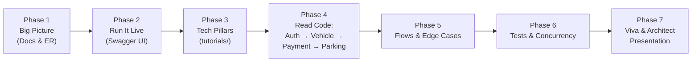

# How to Understand `ParkingSimplified` Step by Step (Master Study Roadmap)

> **Golden Rule of Reading a Codebase:** Never open random files from top to bottom. Always learn **Big Picture $\rightarrow$ Live Running Demo $\rightarrow$ Tech Foundations $\rightarrow$ Simplest Service to Hardest Service $\rightarrow$ Edge Cases & Tests $\rightarrow$ Architecture Defense**.

---

## Visual Study Roadmap

---

## Phase 1: Get the 10,000-Foot Big Picture (Before Reading Code)

**Goal:** Understand *what* the system does, *how* the 4 services and 4 databases sit on your machine, and *why* each tool was chosen.

1. **Map the folders & file types first:**
   Read [DIRECTORY-AND-FILE-GUIDE.md](file:///c:/Users/skamalud/OneDrive%20-%20Capgemini/Documents/ParkingSimplified/coding/DIRECTORY-AND-FILE-GUIDE.md) so file names like `models/`, `schemas/`, `core/security.py`, and `alembic/` instantly make sense.
2. **See the system boundaries:**
   Read [01-ARCHITECTURE-DIAGRAM.md](file:///c:/Users/skamalud/OneDrive%20-%20Capgemini/Documents/ParkingSimplified/architecture-and-docs/01-ARCHITECTURE-DIAGRAM.md) (focus on the 4 ports `8001`–`8004`, Database-per-Service isolation, and the end-to-end sequence diagram).
3. **See all 6 database tables & fields:**
   Read [02-ER-DIAGRAM.md](file:///c:/Users/skamalud/OneDrive%20-%20Capgemini/Documents/ParkingSimplified/architecture-and-docs/02-ER-DIAGRAM.md) and [DATABASE-IMPLEMENTATION-GUIDE.md](file:///c:/Users/skamalud/OneDrive%20-%20Capgemini/Documents/ParkingSimplified/coding/DATABASE-IMPLEMENTATION-GUIDE.md) (focus on *why* there is only 1 SQL Foreign Key and *why* `bookings` stores `vehicle_*_snapshot` columns).
4. **Know why every library is in `requirements.txt`:**
   Skim [WHY-WE-USE-EACH-TOOL.md](file:///c:/Users/skamalud/OneDrive%20-%20Capgemini/Documents/ParkingSimplified/coding/WHY-WE-USE-EACH-TOOL.md) and [DEPENDENCIES.md](file:///c:/Users/skamalud/OneDrive%20-%20Capgemini/Documents/ParkingSimplified/coding/DEPENDENCIES.md).

---

## Phase 2: Boot & Experience the System Live First

**Goal:** Code becomes 10x easier to read once you have actually executed one full booking flow yourself.

1. Follow [RUNNING-COMMANDS.md](file:///c:/Users/skamalud/OneDrive%20-%20Capgemini/Documents/ParkingSimplified/coding/RUNNING-COMMANDS.md) to ensure PostgreSQL is initialized ([init_postgres.sql](file:///c:/Users/skamalud/OneDrive%20-%20Capgemini/Documents/ParkingSimplified/scripts/init_postgres.sql)) and start all 4 services using `.\scripts\start_all.ps1`.
2. Open Swagger UI in your browser (`:8001/docs` through `:8004/docs`) and walk through **one complete happy-path journey** using [API-TESTING-GUIDE.md](file:///c:/Users/skamalud/OneDrive%20-%20Capgemini/Documents/ParkingSimplified/coding/API-TESTING-GUIDE.md):
   - Request OTP (`:8001`) $\rightarrow$ copy 6-digit OTP from terminal $\rightarrow$ Verify OTP $\rightarrow$ copy `access_token`
   - Register an EV car (`:8002`)
   - Check availability & create a booking hold (`:8003`)
   - Process UPI payment (`:8004`)
   - Verify booking status automatically flipped from `PAYMENT_PENDING` to `CONFIRMED` (`:8003`)!

---

## Phase 3: Master the 5 Technical Pillars (`tutorials/`)

**Goal:** Understand the underlying frameworks and patterns before reading the service code line by line. Read the `tutorials/` folder in this exact order:

1. **[fastapi.md](file:///c:/Users/skamalud/OneDrive%20-%20Capgemini/Documents/ParkingSimplified/tutorials/fastapi.md)** — ASGI, Uvicorn, `lifespan`, `APIRouter`, Path/Query/Header, Pydantic DTOs, `Depends`, `HTTPBearer`, custom `AppError` JSON envelopes, `BaseSettings`, `TestClient`.
2. **[sql-and-sqlalchemy.md](file:///c:/Users/skamalud/OneDrive%20-%20Capgemini/Documents/ParkingSimplified/tutorials/sql-and-sqlalchemy.md)** — How every raw SQL query (`CREATE TABLE`, `LEFT OUTER JOIN`, `IS NULL`, `COUNT`, `UPDATE`, `DELETE`, `SELECT ... FOR UPDATE`) converts into SQLAlchemy 2.0.
3. **[sqlalchemy-and-alembic.md](file:///c:/Users/skamalud/OneDrive%20-%20Capgemini/Documents/ParkingSimplified/tutorials/sqlalchemy-and-alembic.md)** — How `Base.metadata`, `alembic.ini`, `env.py`, and `0001_create_parking_tables.py` manage schema evolution cleanly.
4. **[jwt-and-uuid.md](file:///c:/Users/skamalud/OneDrive%20-%20Capgemini/Documents/ParkingSimplified/tutorials/jwt-and-uuid.md)** — Why UUIDs prevent IDOR, how HS256 JWTs work across 4 services without DB lookups, and `AuthContext` token forwarding.
5. **[microservices-communication-and-concurrency.md](file:///c:/Users/skamalud/OneDrive%20-%20Capgemini/Documents/ParkingSimplified/tutorials/microservices-communication-and-concurrency.md)** — Sync `httpx` vs callbacks, 3s timeouts, snapshots, idempotency, TOCTOU race conditions, and `FOR UPDATE` slot locking.

---

## Phase 4: Read the Source Code (From Simplest Service $\rightarrow$ Core Service)

**Inside every single service**, always read files in this **bottom-up order**:
`main.py` $\rightarrow$ `core/config.py` & `core/database.py` $\rightarrow$ `models/` $\rightarrow$ `schemas/` $\rightarrow$ `core/security.py` & `services/` $\rightarrow$ `api/`

### Step 4A — Start with `user-auth-service` (Simplest Service, Entry Door)
1. [main.py](file:///c:/Users/skamalud/OneDrive%20-%20Capgemini/Documents/ParkingSimplified/services/user-auth-service/app/main.py) & [config.py](file:///c:/Users/skamalud/OneDrive%20-%20Capgemini/Documents/ParkingSimplified/services/user-auth-service/app/core/config.py)
2. [models/auth.py](file:///c:/Users/skamalud/OneDrive%20-%20Capgemini/Documents/ParkingSimplified/services/user-auth-service/app/models/auth.py) & [schemas/auth.py](file:///c:/Users/skamalud/OneDrive%20-%20Capgemini/Documents/ParkingSimplified/services/user-auth-service/app/schemas/auth.py)
3. [core/security.py](file:///c:/Users/skamalud/OneDrive%20-%20Capgemini/Documents/ParkingSimplified/services/user-auth-service/app/core/security.py) & [email_sender.py](file:///c:/Users/skamalud/OneDrive%20-%20Capgemini/Documents/ParkingSimplified/services/user-auth-service/app/services/email_sender.py)
4. [api/v1/auth.py](file:///c:/Users/skamalud/OneDrive%20-%20Capgemini/Documents/ParkingSimplified/services/user-auth-service/app/api/v1/auth.py)
5. *Cross-check with:* [AUTHENTICATION-FLOW-GUIDE.md](file:///c:/Users/skamalud/OneDrive%20-%20Capgemini/Documents/ParkingSimplified/coding/AUTHENTICATION-FLOW-GUIDE.md)

### Step 4B — Move to `vehicle-service` (Clean Standalone CRUD)
1. [models/vehicle.py](file:///c:/Users/skamalud/OneDrive%20-%20Capgemini/Documents/ParkingSimplified/services/vehicle-service/app/models/vehicle.py) & [schemas/vehicle.py](file:///c:/Users/skamalud/OneDrive%20-%20Capgemini/Documents/ParkingSimplified/services/vehicle-service/app/schemas/vehicle.py) *(focus on `normalize_vehicle_number`)*
2. [core/security.py](file:///c:/Users/skamalud/OneDrive%20-%20Capgemini/Documents/ParkingSimplified/services/vehicle-service/app/core/security.py) *(notice zero DB lookup here!)*
3. [api/v1/vehicles.py](file:///c:/Users/skamalud/OneDrive%20-%20Capgemini/Documents/ParkingSimplified/services/vehicle-service/app/api/v1/vehicles.py) *(focus on `_get_owned_active_vehicle` IDOR check and `is_active = False` soft delete)*

### Step 4C — Move to `payment-service` (Idempotency & Internal Callbacks)
1. [models/payment.py](file:///c:/Users/skamalud/OneDrive%20-%20Capgemini/Documents/ParkingSimplified/services/payment-service/app/models/payment.py) & [schemas/payment.py](file:///c:/Users/skamalud/OneDrive%20-%20Capgemini/Documents/ParkingSimplified/services/payment-service/app/schemas/payment.py)
2. [core/security.py](file:///c:/Users/skamalud/OneDrive%20-%20Capgemini/Documents/ParkingSimplified/services/payment-service/app/core/security.py) & [parking_callback.py](file:///c:/Users/skamalud/OneDrive%20-%20Capgemini/Documents/ParkingSimplified/services/payment-service/app/services/parking_callback.py)
3. [api/v1/payments.py](file:///c:/Users/skamalud/OneDrive%20-%20Capgemini/Documents/ParkingSimplified/services/payment-service/app/api/v1/payments.py) *(focus on idempotent `/internal/v1/payments` and `_resolve_simulated_outcome`)*
4. *Cross-check with:* [PAYMENT-SIMULATION-GUIDE.md](file:///c:/Users/skamalud/OneDrive%20-%20Capgemini/Documents/ParkingSimplified/coding/PAYMENT-SIMULATION-GUIDE.md)

### Step 4D — Tackle `parking-service` (The Core Orchestrator & Concurrency Engine)
1. [core/clock.py](file:///c:/Users/skamalud/OneDrive%20-%20Capgemini/Documents/ParkingSimplified/services/parking-service/app/core/clock.py) & [core/security.py](file:///c:/Users/skamalud/OneDrive%20-%20Capgemini/Documents/ParkingSimplified/services/parking-service/app/core/security.py) *(`AuthContext`)*
2. [models/parking.py](file:///c:/Users/skamalud/OneDrive%20-%20Capgemini/Documents/ParkingSimplified/services/parking-service/app/models/parking.py) *(`ParkingSlot`, `Booking`, `seed_default_slots`)*
3. [services/rules.py](file:///c:/Users/skamalud/OneDrive%20-%20Capgemini/Documents/ParkingSimplified/services/parking-service/app/services/rules.py) *(all business rules & ₹10/₹20 pricing)*
4. [services/clients.py](file:///c:/Users/skamalud/OneDrive%20-%20Capgemini/Documents/ParkingSimplified/services/parking-service/app/services/clients.py) *(`VehicleServiceClient` & `PaymentServiceClient`)*
5. [api/v1/parking.py](file:///c:/Users/skamalud/OneDrive%20-%20Capgemini/Documents/ParkingSimplified/services/parking-service/app/api/v1/parking.py) *(read `create_booking` line-by-line: rules $\rightarrow$ vehicle check $\rightarrow$ `FOR UPDATE` $\rightarrow$ overlap check $\rightarrow$ commit hold $\rightarrow$ payment client!)*
6. [api/internal.py](file:///c:/Users/skamalud/OneDrive%20-%20Capgemini/Documents/ParkingSimplified/services/parking-service/app/api/internal.py) *(`apply_payment_result` & `EXPIRED_NO_RESURRECTION`)*
7. [0001_create_parking_tables.py](file:///c:/Users/skamalud/OneDrive%20-%20Capgemini/Documents/ParkingSimplified/services/parking-service/alembic/versions/0001_create_parking_tables.py)
8. *Cross-check with:* [03-LOW-LEVEL-DESIGN.md](file:///c:/Users/skamalud/OneDrive%20-%20Capgemini/Documents/ParkingSimplified/architecture-and-docs/03-LOW-LEVEL-DESIGN.md)

---

## Phase 5: Connect Features, Cross-Service Flows & Edge Cases

**Goal:** Switch from reading "one file at a time" to tracing **one business scenario across multiple files**.

1. Read [API-FLOWS.md](file:///c:/Users/skamalud/OneDrive%20-%20Capgemini/Documents/ParkingSimplified/coding/API-FLOWS.md) to trace every request/callback arrow end-to-end.
2. Read [FEATURE-TO-CODE-MAP.md](file:///c:/Users/skamalud/OneDrive%20-%20Capgemini/Documents/ParkingSimplified/coding/FEATURE-TO-CODE-MAP.md) to answer *"Which exact file and function implements feature X?"* immediately.
3. Read [EDGE-CASES-AND-TECHNIQUES.md](file:///c:/Users/skamalud/OneDrive%20-%20Capgemini/Documents/ParkingSimplified/coding/EDGE-CASES-AND-TECHNIQUES.md) to master every failure, security, timezone, and race-condition defense.

---

## Phase 6: Study & Run the Automated Tests

**Goal:** Verify how every unit, concurrency, and end-to-end guarantee is proven in code.

Read the test files in this order:
1. **Isolated Service Tests (SQLite + Mocks):**
   * [test_auth.py](file:///c:/Users/skamalud/OneDrive%20-%20Capgemini/Documents/ParkingSimplified/services/user-auth-service/tests/test_auth.py)
   * [test_vehicles.py](file:///c:/Users/skamalud/OneDrive%20-%20Capgemini/Documents/ParkingSimplified/services/vehicle-service/tests/test_vehicles.py)
   * [test_payments.py](file:///c:/Users/skamalud/OneDrive%20-%20Capgemini/Documents/ParkingSimplified/services/payment-service/tests/test_payments.py)
   * [test_parking.py](file:///c:/Users/skamalud/OneDrive%20-%20Capgemini/Documents/ParkingSimplified/services/parking-service/tests/test_parking.py) & [test_internal.py](file:///c:/Users/skamalud/OneDrive%20-%20Capgemini/Documents/ParkingSimplified/services/parking-service/tests/test_internal.py)
2. **Real PostgreSQL Race-Condition Proof:**
   * [test_pg_concurrency.py](file:///c:/Users/skamalud/OneDrive%20-%20Capgemini/Documents/ParkingSimplified/tests/test_pg_concurrency.py) *(10 threads racing for 5 EV slots + 4-tab self-overlap)*
3. **Full 4-Service Live E2E Journey:**
   * [test_e2e_journey.py](file:///c:/Users/skamalud/OneDrive%20-%20Capgemini/Documents/ParkingSimplified/tests/test_e2e_journey.py)
4. **Run all 7 suites together:** `.\scripts\run_all_tests.ps1`

---

## Phase 7: Presentation & Self-Test Readiness

**Goal:** Switch into "Architect & Demo Mode" using the presentation docs.

1. Review [PRESENTATION-AND-EVALUATION-GUIDE.md](file:///c:/Users/skamalud/OneDrive%20-%20Capgemini/Documents/ParkingSimplified/coding/PRESENTATION-AND-EVALUATION-GUIDE.md) and [04-API-DOCUMENTATION.md](file:///c:/Users/skamalud/OneDrive%20-%20Capgemini/Documents/ParkingSimplified/architecture-and-docs/04-API-DOCUMENTATION.md).
2. **10-Point Mastery Self-Check** *(if you can answer all 10 without notes, you know the entire project deeply)*:
   1. Why are there 4 separate PostgreSQL databases with `REVOKE CONNECT ... FROM PUBLIC`?
   2. How does `vehicle-service` verify a JWT without calling `user-auth-service`?
   3. Why does `parking-service` store `vehicle_number_snapshot` instead of querying `vehicle-service` when listing bookings?
   4. Why do we lock `parking_slots` with `SELECT ... FOR UPDATE` instead of locking `bookings`?
   5. Why does `create_booking()` call `db.commit()` **before** calling `payment-service` over HTTP?
   6. How does lazy hold expiration work without any background cron job?
   7. What happens if a late `"SUCCESS"` payment callback arrives after the 5-minute hold expired?
   8. How does `POST /internal/v1/payments` stay idempotent on network retries?
   9. Why are internal endpoints guarded by `X-Internal-Service-Token` instead of user JWTs?
   10. Why do unit tests use `app.dependency_overrides` with SQLite `StaticPool`, and why do we still need `test_pg_concurrency.py` on real PostgreSQL?
