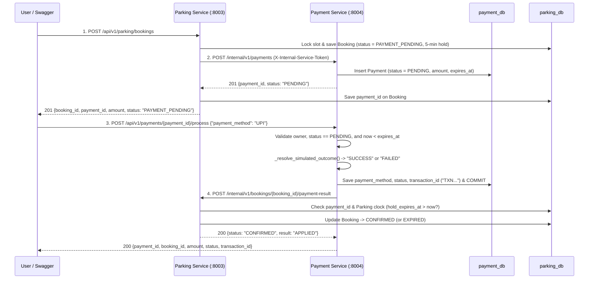

# How Simulated Payment Works (End-to-End Guide)

A complete explanation of how `Parking Service` (`:8003`) and `Payment Service` (`:8004`) simulate payments without a real payment gateway (no Stripe, Razorpay, or real UPI/card data)—and how payment outcomes safely update booking status.

---

## 1. Core Design Philosophy

1. **No Real Money / Sensitive Data:** The client only chooses a simulated `payment_method` (`"UPI"`, `"CARD"`, or `"WALLET"`). No card numbers, CVVs, or UPI PINs are accepted or stored.
2. **Backend-Controlled Amount & Outcome:**
   - **Parking Service** calculates `amount` (`₹10/hr` normal or `₹20/hr` EV charging) and sends it to Payment Service; the client cannot tamper with the price.
   - **Payment Service** decides whether the payment succeeds or fails (`_resolve_simulated_outcome`); the client cannot send `"status": "SUCCESS"` in the JSON body.
3. **One Payment Per Booking (`UNIQUE(booking_id)`):** A booking can only have one payment attempt. If payment fails or expires, the booking becomes `EXPIRED` and the user creates a new booking.

---

## 2. Step-by-Step Lifecycle (From Booking to Confirmation)



---

## 3. Step 1: Payment Creation (`Parking → Payment`)

- When `create_booking()` in [parking.py](file:///c:/Users/skamalud/OneDrive%20-%20Capgemini/Documents/ParkingSimplified/services/parking-service/app/api/v1/parking.py) commits the `PAYMENT_PENDING` booking with a 5-minute `hold_expires_at`, it calls `PaymentServiceClient.create_payment()` in [clients.py](file:///c:/Users/skamalud/OneDrive%20-%20Capgemini/Documents/ParkingSimplified/services/parking-service/app/services/clients.py).
- That sends `POST http://127.0.0.1:8004/internal/v1/payments` with header `X-Internal-Service-Token: dev-internal-service-token`.
- In `Payment Service` ([payments.py](file:///c:/Users/skamalud/OneDrive%20-%20Capgemini/Documents/ParkingSimplified/services/payment-service/app/api/v1/payments.py)):
  - `require_parking_service_token()` verifies `X-Internal-Service-Token` (`401` if invalid).
  - `create_internal_payment()` checks `Payment.booking_id` (`UNIQUE`):
    - If a matching payment already exists (`same_user` and `same_amount`), it replays it with `200 OK` (idempotent).
    - If a payment exists for that `booking_id` with conflicting `user_id` or `amount`, it returns `409 PAYMENT_REQUEST_CONFLICT`.
    - Otherwise, it inserts a new `Payment` row with `status="PENDING"` and returns `201 Created`.

---

## 4. Step 2: How Outcome Simulation Works (`_resolve_simulated_outcome`)

When the user calls `POST /api/v1/payments/{payment_id}/process` with `{"payment_method": "UPI" | "CARD" | "WALLET"}`:

1. **Pre-Checks in `process_payment()`:**
   - **Ownership:** Queries `Payment.id == payment_id AND Payment.user_id == user_id` (`404 PAYMENT_NOT_FOUND` if missing or another user's payment).
   - **Single Processing:** If `payment.status != "PENDING"`, returns `409 PAYMENT_ALREADY_PROCESSED`.
   - **Expiry Check:** If `now_utc >= payment.expires_at`, returns `409 PAYMENT_EXPIRED`.

2. **Outcome Decision (`_resolve_simulated_outcome` in [payments.py](file:///c:/Users/skamalud/OneDrive%20-%20Capgemini/Documents/ParkingSimplified/services/payment-service/app/api/v1/payments.py)):**
   ```python
   def _resolve_simulated_outcome(test_override: str | None) -> str:
       if (
           test_override is not None
           and settings.ENABLE_TEST_PAYMENT_OVERRIDE
           and settings.ENVIRONMENT.strip().lower() != "production"
       ):
           upper = test_override.strip().upper()
           if upper in ("SUCCESS", "FAILED"):
               return upper

       default_outcome = settings.PAYMENT_SIMULATION_DEFAULT_OUTCOME.strip().upper()
       return "FAILED" if default_outcome == "FAILED" else "SUCCESS"
   ```
   - **Default Demo Behavior:** `PAYMENT_SIMULATION_DEFAULT_OUTCOME` defaults to `"SUCCESS"` in `config.py` / `.env.example`, so normal Swagger demos succeed predictably.
   - **Testing Failure Scenarios:** In non-production (`ENVIRONMENT != "production"` and `ENABLE_TEST_PAYMENT_OVERRIDE=true`), you can pass the HTTP header `X-Test-Payment-Outcome: FAILED` to force a deterministic simulated failure!

3. **Transaction ID Generation & DB Commit:**
   - If `"SUCCESS"`, generates a simulated reference: `txn_id = f"TXN{uuid.uuid4().hex[:10].upper()}"` (e.g., `"TXN9A3F1C08E2"`).
   - If `"FAILED"`, `txn_id = None`.
   - Saves `payment_method`, `status`, and `transaction_id` to `payment_db` and **commits before calling Parking Service**.

---

## 5. Step 3: Callback to Confirm or Expire the Booking (`Payment → Parking`)

Immediately after committing `payment_db`, `process_payment()` calls `ParkingCallbackClient.deliver_payment_result()` in [parking_callback.py](file:///c:/Users/skamalud/OneDrive%20-%20Capgemini/Documents/ParkingSimplified/services/payment-service/app/services/parking_callback.py):
- Sends `POST http://127.0.0.1:8003/internal/v1/bookings/{booking_id}/payment-result` with `X-Internal-Service-Token`.
- Inside `apply_payment_result()` in [internal.py](file:///c:/Users/skamalud/OneDrive%20-%20Capgemini/Documents/ParkingSimplified/services/parking-service/app/api/internal.py):
  1. Verifies `X-Internal-Service-Token` (`_require_internal_token`).
  2. Verifies `booking` exists (`404`) and `booking.payment_id` matches (`409 PAYMENT_REFERENCE_MISMATCH`).
  3. **Idempotent / Terminal Guards:**
     - If already `CONFIRMED` → returns `200` (`result="ALREADY_APPLIED"`).
     - If already `EXPIRED` → returns `200` (`result="EXPIRED_NO_RESURRECTION"`).
     - If `CANCELLED` → returns `409 INVALID_BOOKING_TRANSITION`.
  4. **Authoritative Hold Expiry Check (No Resurrection):**
     - Parking Service uses its **own clock** (`now_utc`) to check `hold_expires_at <= now_utc`.
     - If the hold expired OR `payload.status == "FAILED"` → transitions booking to **`EXPIRED`**.
     - Only if the hold is still valid AND `payload.status == "SUCCESS"` → transitions booking to **`CONFIRMED`**.

---

## 6. How to Test Both Success and Failure Yourself

1. **Simulate Success (Default):**
   - Call `POST /api/v1/payments/{payment_id}/process` with `{"payment_method": "UPI"}`.
   - Payment becomes `SUCCESS` (`TXN...`) and `GET /api/v1/parking/bookings/{booking_id}` shows `CONFIRMED`.
2. **Simulate Failure (`X-Test-Payment-Outcome: FAILED`):**
   - Create a new booking in `:8003/docs`, copy its `payment_id`, then call `POST /api/v1/payments/{payment_id}/process` passing header `X-Test-Payment-Outcome: FAILED` (for example via `curl.exe` or Swagger).
   - Payment becomes `FAILED` (`transaction_id: null`) and `GET /api/v1/parking/bookings/{booking_id}` shows `EXPIRED`, freeing the slot immediately for other users.
