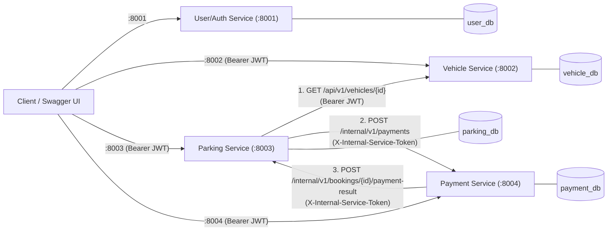

# System Architecture

## 1. Architectural Style
The system is built as **4 independent FastAPI microservices**, each owning its own isolated PostgreSQL database (`user_db`, `vehicle_db`, `parking_db`, `payment_db`). No service ever connects to or queries another service's database directly; all cross-service interactions happen over HTTP using `httpx` and stateless **HS256 JWT** / `X-Internal-Service-Token` headers.

---

## 2. Component Inventory

| Service | Port | Database | Tables | Responsibilities |
|---|---:|---|---|---|
| **User/Auth Service** | `8001` | `user_db` | `users`, `verification_codes` | Corporate email OTP verification, user creation, HS256 JWT issuance, `/users/me` |
| **Vehicle Service** | `8002` | `vehicle_db` | `vehicles` | Standalone owner-scoped vehicle CRUD, plate normalization, soft delete |
| **Parking Service** | `8003` | `parking_db` | `parking_slots`, `bookings` | Slot seeding, availability, `FOR UPDATE` slot locking, 5-min holds, fee calculation, cancellation |
| **Payment Service** | `8004` | `payment_db` | `payments` | Internal payment creation, simulated payment processing (`UPI`/`CARD`/`WALLET`), callback to Parking |

---

## 3. High-Level Architecture Diagram

---

## 4. Data Ownership & Foreign Key Boundary

- **Within the same database (`parking_db`):** `bookings.slot_id` uses a real SQL `ForeignKey("parking_slots.id")`.
- **Across different microservice databases:** `user_id`, `vehicle_id`, `booking_id`, and `payment_id` are stored as logical UUID columns without cross-database SQL foreign keys:
  - `user_id` is verified from the signed **HS256 JWT** (`sub` claim).
  - `vehicle_id` is verified by `Parking Service` calling `Vehicle Service` (`GET /api/v1/vehicles/{id}`) and copying `vehicle_number_snapshot`, `vehicle_type_snapshot`, and `is_ev_snapshot` onto the booking.
  - `booking_id` and `payment_id` are synchronized between `Parking Service` and `Payment Service` via internal HTTP endpoints protected by `X-Internal-Service-Token`.

---

## 5. Schema Management & Alembic Demonstration

- Every service calls `Base.metadata.create_all(bind=engine)` on startup in `app/main.py` so tables are created automatically.
- `parking-service` also runs `seed_default_slots(db)` on startup to seed the 100 parking slots (`C01–C60`, `B01–B40`) when `parking_slots` is empty.
- In addition, **`parking-service` includes an Alembic migration setup** (`services/parking-service/alembic/`) for `parking_db` to demonstrate versioned database schema migrations (`upgrade` / `downgrade`) on the core multi-table relational domain.
