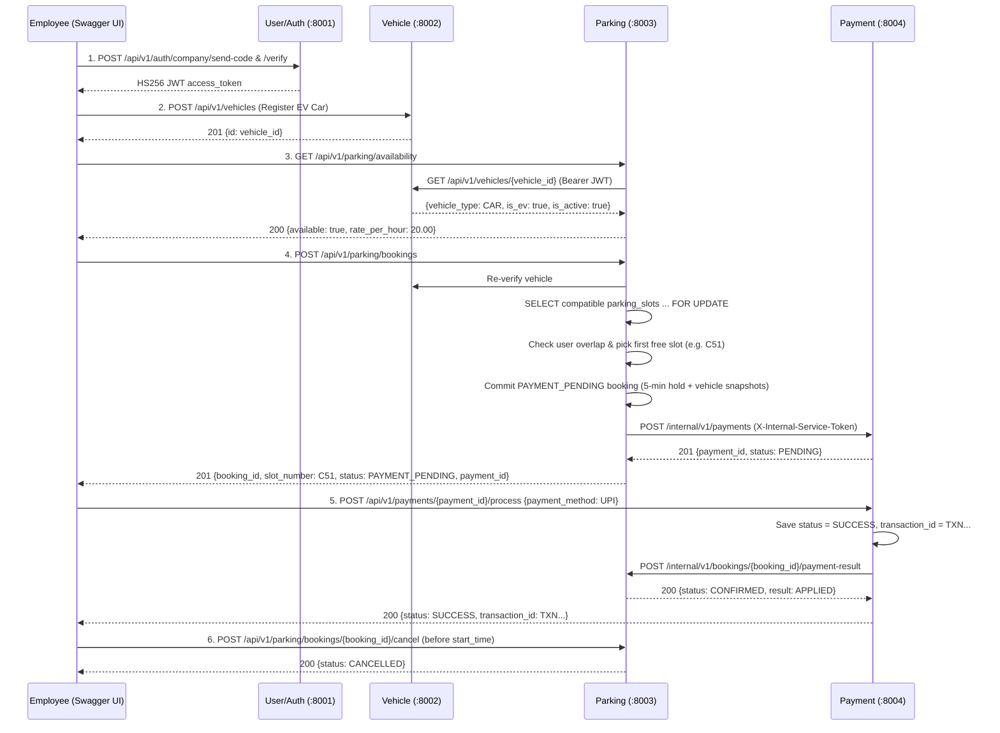

# End-to-End Workflows and Reliability

## 1. Core End-to-End User Journey

---

## 2. Concurrency Protection (`SELECT ... FOR UPDATE`)

Inside `POST /api/v1/parking/bookings`:
1. `Parking Service` queries all compatible `ParkingSlot` rows (`vehicle_type == vehicle.vehicle_type` and `is_charging_enabled == payload.requires_charging`) ordered by `slot_number ASC` with `.with_for_update()`.
2. In PostgreSQL, `SELECT ... FOR UPDATE` locks those slot rows for the duration of the transaction, serializing concurrent booking attempts.
3. While holding the row locks, `Parking Service` checks for same-user overlap (`409 USER_BOOKING_OVERLAP`) and occupied slots, picks the first free slot (`409 NO_PARKING_CAPACITY` if all are taken), inserts the `PAYMENT_PENDING` booking, and commits before calling `Payment Service`.

---

## 3. Lazy Hold Expiry (No Background Daemons Needed)

- Every `PAYMENT_PENDING` booking has `hold_expires_at = created_at + 5 minutes`.
- Availability and overlap queries only treat a `PAYMENT_PENDING` booking as active if `hold_expires_at > now()`.
- Whenever `GET /api/v1/parking/bookings`, `GET /api/v1/parking/bookings/{id}`, `POST /cancel`, or the internal payment callback accesses a `PAYMENT_PENDING` booking whose `hold_expires_at <= now()`, it automatically updates `status = "EXPIRED"`.
