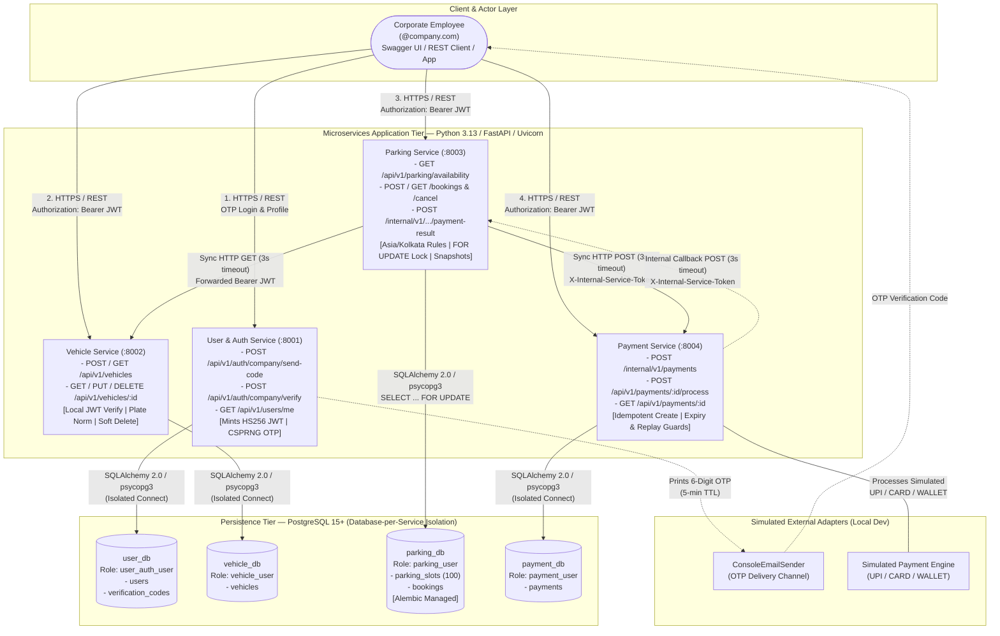
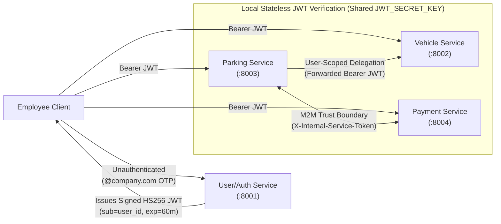

# System Architecture Diagram — Corporate Parking Platform (`ParkingSimplified`)

> **Diagram Standard:** Enterprise C4-Container / Layered System Architecture showing Clients, Security Boundaries, Microservices, Sync/Async Inter-Service Contracts, and Isolated PostgreSQL Databases.

---

## 1. Full System Architecture (Layered Blueprint)

---

## 2. Security Boundaries & Cross-Service Trust Topology

---

## 3. Architectural Components Summary

| Layer | Component | Responsibility & Key Mechanism |
| :--- | :--- | :--- |
| **Client Layer** | Employee / API Consumer | Calls public `/api/v1/*` endpoints directly on ports `8001`–`8004` using `Authorization: Bearer <JWT>`. |
| **Identity & Auth** | `user-auth-service` (`:8001`) | Restricts login to `@company.com`, generates CSPRNG 6-digit OTPs, provisions users lazily, and mints HS256 JWTs. |
| **Vehicle Registry** | `vehicle-service` (`:8002`) | Verifies JWT locally, normalizes license plates (`KA01AB1234`), prevents active duplicates, and uses soft deletes (`is_active=False`). |
| **Booking Core** | `parking-service` (`:8003`) | Enforces `Asia/Kolkata` facility rules, locks compatible slots via PostgreSQL `SELECT ... FOR UPDATE`, snapshots vehicle info, and expires 5-minute holds lazily. |
| **Payment Engine** | `payment-service` (`:8004`) | Creates idempotent pending payments, simulates `UPI`/`CARD`/`WALLET` settlement, blocks double/expired payments, and notifies `parking-service`. |
| **Data Layer** | 4 Isolated PostgreSQL DBs | Enforces Database-per-Service (`REVOKE CONNECT ... FROM PUBLIC`); zero cross-database SQL `JOIN`s or foreign keys. |
