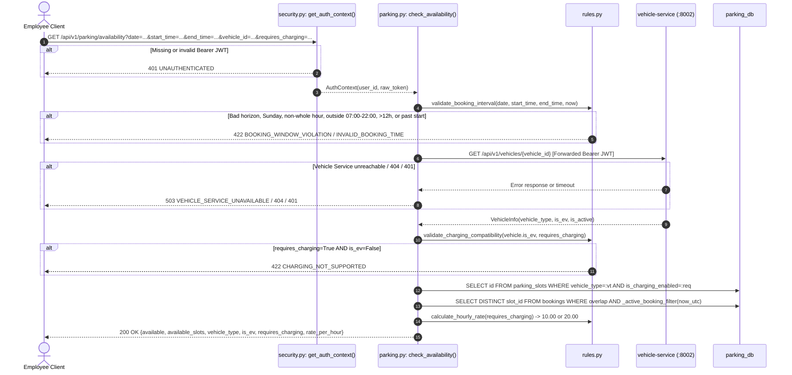
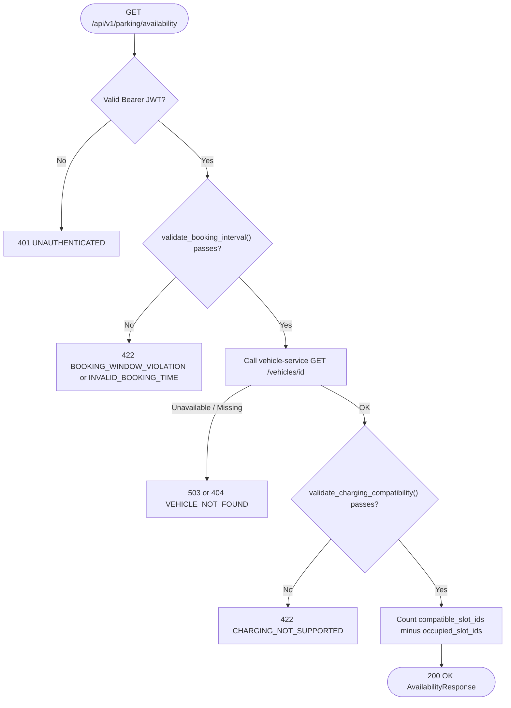

# API Flow: `GET /api/v1/parking/availability`

- **Service:** `parking-service` (`:8003`)
- **Router / Handler:** [parking.py](file:///c:/Users/skamalud/OneDrive%20-%20Capgemini/Documents/ParkingSimplified/services/parking-service/app/api/v1/parking.py) $\rightarrow$ `check_availability()`
- **Authentication:** `Authorization: Bearer <JWT>` (`Depends(get_auth_context)`)
- **Cross-Service Calls:** `VehicleServiceClient.get_owned_vehicle` $\rightarrow$ `vehicle-service` (`:8002`)
- **Database:** `parking_db` (`parking_slots`, `bookings`)

---

## Sequence Diagram

---

## Step-by-Step Decision Flow

