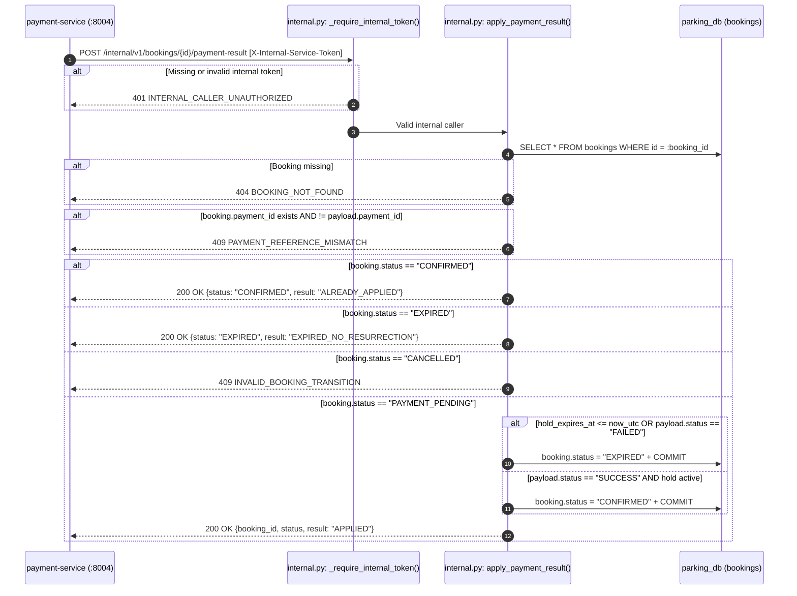
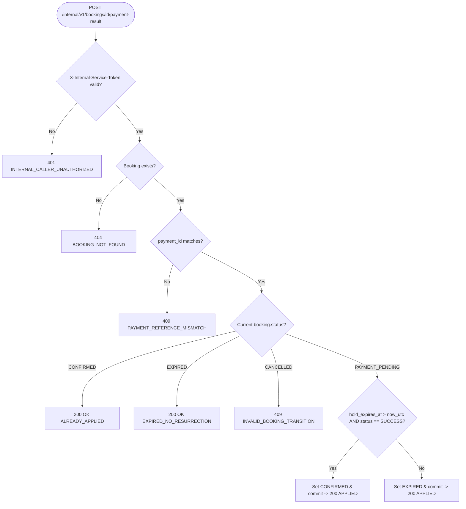

# API Flow: `POST /internal/v1/bookings/{booking_id}/payment-result`

- **Service:** `parking-service` (`:8003`)
- **Router / Handler:** [internal.py](file:///c:/Users/skamalud/OneDrive%20-%20Capgemini/Documents/ParkingSimplified/services/parking-service/app/api/internal.py) $\rightarrow$ `apply_payment_result()`
- **Authentication:** `X-Internal-Service-Token` (`dependencies=[Depends(_require_internal_token)]`)
- **Called By:** `payment-service` (`ParkingCallbackClient.deliver_payment_result`)
- **Database:** `parking_db` (`bookings`)

---

## Sequence Diagram

---

## Step-by-Step Decision Flow

