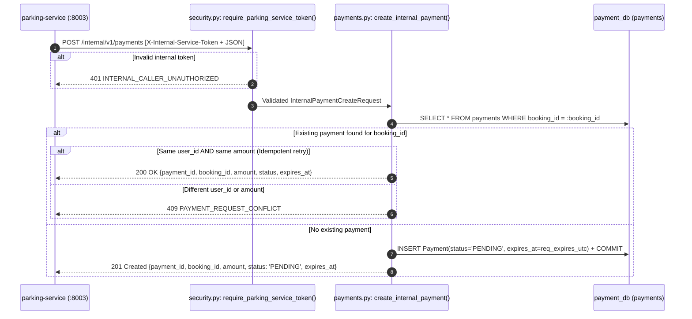
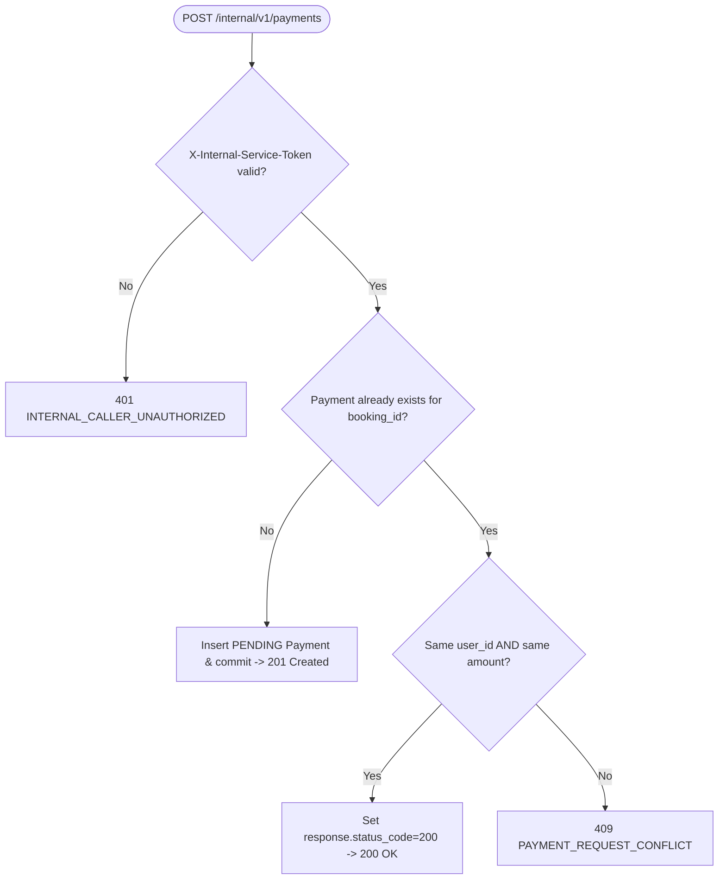

# API Flow: `POST /internal/v1/payments`

- **Service:** `payment-service` (`:8004`)
- **Router / Handler:** [payments.py](file:///c:/Users/skamalud/OneDrive%20-%20Capgemini/Documents/ParkingSimplified/services/payment-service/app/api/v1/payments.py) $\rightarrow$ `create_internal_payment()`
- **Authentication:** `X-Internal-Service-Token` (`dependencies=[Depends(require_parking_service_token)]`)
- **Called By:** `parking-service` (`PaymentServiceClient.create_payment`)
- **Database:** `payment_db` (`payments`)

---

## Sequence Diagram

---

## Step-by-Step Decision Flow

