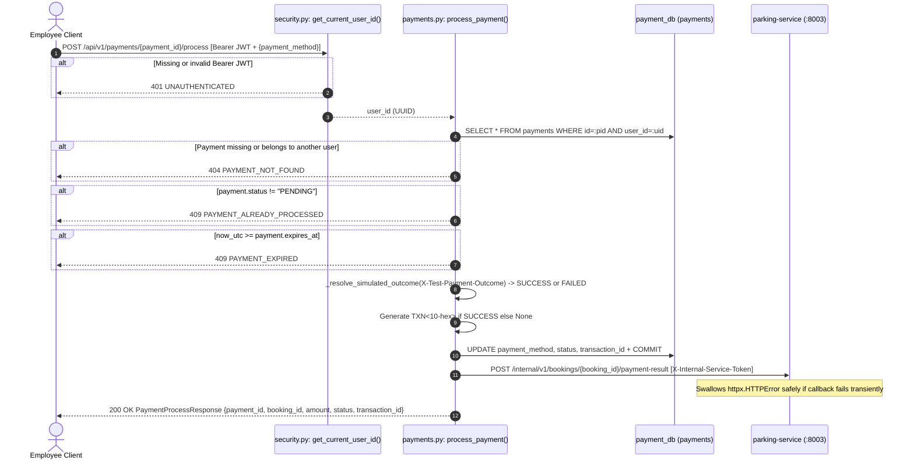
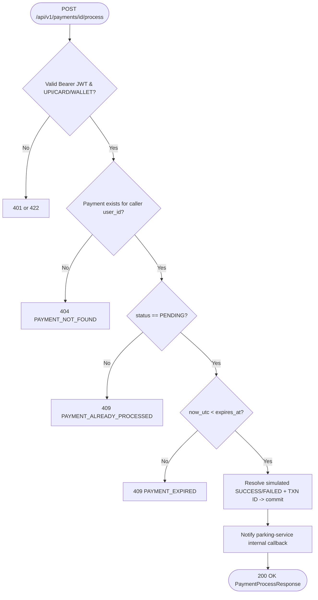

# API Flow: `POST /api/v1/payments/{payment_id}/process`

- **Service:** `payment-service` (`:8004`)
- **Router / Handler:** [payments.py](file:///c:/Users/skamalud/OneDrive%20-%20Capgemini/Documents/ParkingSimplified/services/payment-service/app/api/v1/payments.py) $\rightarrow$ `process_payment()`
- **Authentication:** `Authorization: Bearer <JWT>` (`Depends(get_current_user_id)`)
- **Cross-Service Callback:** `ParkingCallbackClient.deliver_payment_result` $\rightarrow$ `parking-service` (`:8003`)
- **Database:** `payment_db` (`payments`)

---

## Sequence Diagram

---

## Step-by-Step Decision Flow

