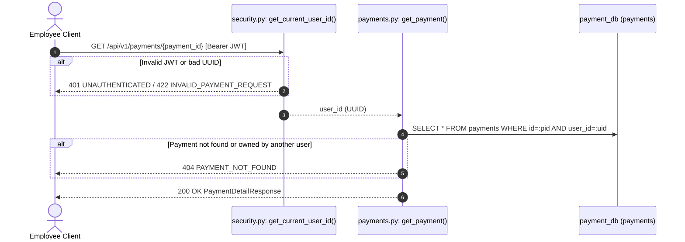
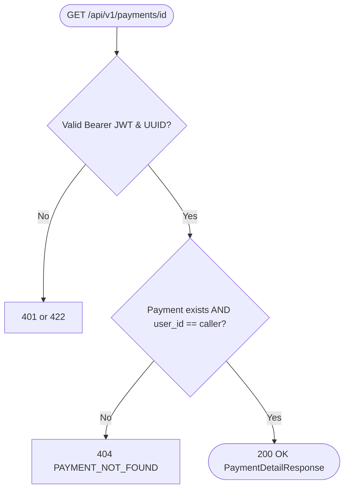

# API Flow: `GET /api/v1/payments/{payment_id}`

- **Service:** `payment-service` (`:8004`)
- **Router / Handler:** [payments.py](file:///c:/Users/skamalud/OneDrive%20-%20Capgemini/Documents/ParkingSimplified/services/payment-service/app/api/v1/payments.py) $\rightarrow$ `get_payment()`
- **Authentication:** `Authorization: Bearer <JWT>` (`Depends(get_current_user_id)`)
- **Database:** `payment_db` (`payments`)

---

## Sequence Diagram

---

## Step-by-Step Decision Flow

