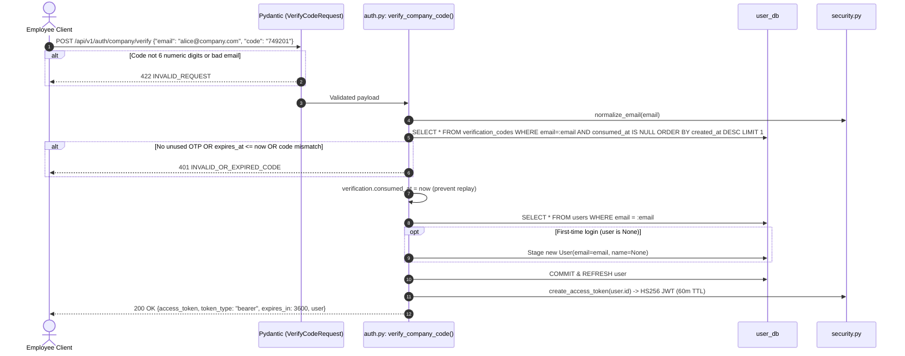
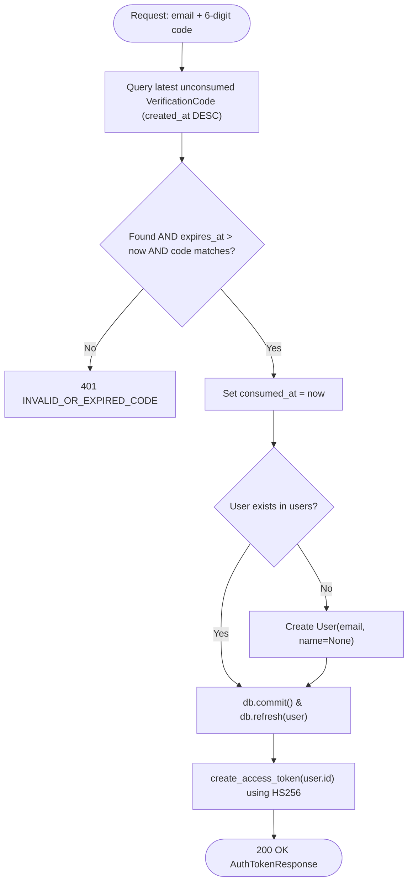

# API Flow: `POST /api/v1/auth/company/verify`

- **Service:** `user-auth-service` (`:8001`)
- **Router / Handler:** [auth.py](file:///c:/Users/skamalud/OneDrive%20-%20Capgemini/Documents/ParkingSimplified/services/user-auth-service/app/api/v1/auth.py) $\rightarrow$ `verify_company_code()`
- **Authentication:** Public (exchanges OTP for HS256 JWT)
- **Database:** `user_db` (`verification_codes`, `users`)

---

## Sequence Diagram

---

## Step-by-Step Decision Flow

