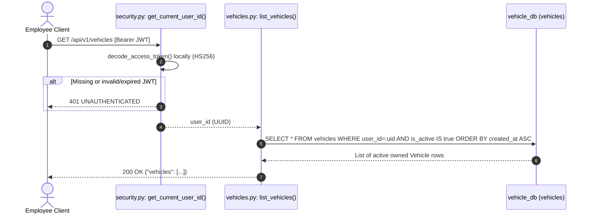
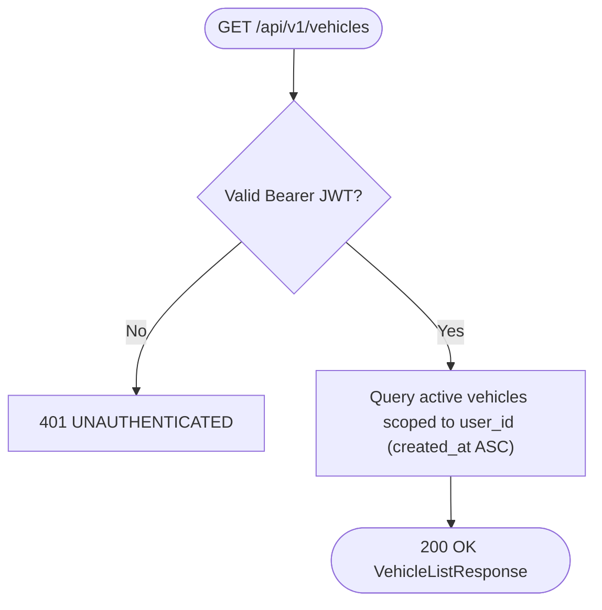

# API Flow: `GET /api/v1/vehicles`

- **Service:** `vehicle-service` (`:8002`)
- **Router / Handler:** [vehicles.py](file:///c:/Users/skamalud/OneDrive%20-%20Capgemini/Documents/ParkingSimplified/services/vehicle-service/app/api/v1/vehicles.py) $\rightarrow$ `list_vehicles()`
- **Authentication:** `Authorization: Bearer <JWT>` (`Depends(get_current_user_id)`)
- **Database:** `vehicle_db` (`vehicles`)

---

## Sequence Diagram

---

## Step-by-Step Decision Flow

