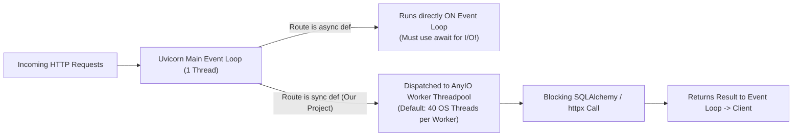

# Synchronous vs. Asynchronous Architecture Decisions — Complete Evaluation & Architect Defense Guide

> **Why this guide exists:** Evaluators, senior developers, and architects very commonly ask: *"FastAPI is famous for `async`—why are your routes, database calls, and microservice communications synchronous?"*
> 
> This guide explains **exactly** how `ParkingSimplified` works under the hood, why our synchronous choices are intentional and safe, what the real trade-offs are, and **word-for-word answers** for technical evaluations.

---

## Course Outline

1. **Topic 1: The Two Meanings of "Sync vs. Async" in `ParkingSimplified`**
2. **Topic 2: How FastAPI Actually Executes `def` vs `async def` Under the Hood**
3. **Topic 3: Why We Chose Synchronous `def` + Sync SQLAlchemy (Instead of `asyncpg` / `AsyncSession`)**
4. **Topic 4: Why We Chose Synchronous REST (`httpx`) Instead of Kafka / RabbitMQ / Celery**
5. **Topic 5: Honest Trade-Offs & Where Synchronous Design Has Limits**
6. **Topic 6: Real-World Traffic Scenarios & Capacity Math (Can It Handle 100–200 Requests?)**
7. **Topic 7: Architect & Evaluator Cross-Questioning Playbook (Word-for-Word Answers)**

---

## Topic 1: The Two Meanings of "Sync vs. Async" in `ParkingSimplified`

When someone asks about "sync vs. async", they are actually asking about **two completely separate layers**:

| Layer | Question | What `ParkingSimplified` Uses |
| :--- | :--- | :--- |
| **1. Code Execution Level** *(Inside one service)* | Do route functions use `def` or `async def`? Are DB/HTTP drivers blocking or non-blocking? | **Synchronous `def` routes**, synchronous SQLAlchemy `Session` (`psycopg`), and synchronous `httpx.Client`. *(Only framework hooks `lifespan` and `errors.py` handlers use `async def`).* |
| **2. Microservice Communication Level** *(Between services)* | Do services wait for REST replies, or drop events into a queue like Kafka/RabbitMQ? | **Synchronous Request-Response REST (`httpx.Client` with `timeout=3.0`)** + a **5-minute Saga Hold + HTTP Callback** (`deliver_payment_result`). No Kafka, RabbitMQ, Redis, or Celery. |

### Exact Inventory of Our Codebase

| Component / File | Mode | What It Does |
| :--- | :--- | :--- |
| `app/main.py` (`async def lifespan`) | `async def` | Required by FastAPI/ASGI startup & shutdown protocol; runs once on boot/stop. |
| `app/core/errors.py` (exception handlers) | `async def` | Does zero DB/network I/O—immediately returns `JSONResponse`. |
| All API routes (`auth.py`, `vehicles.py`, `parking.py`, `internal.py`, `payments.py`) | **Sync `def`** | Handles business logic, validation, and DB queries safely in FastAPI's worker threadpool. |
| Database (`database.py`, `create_engine`, `Session`) | **Sync** | Uses standard SQLAlchemy 2.0 + `psycopg` driver with `pool_pre_ping=True`. |
| Service-to-service clients (`clients.py`, `parking_callback.py`) | **Sync** | Uses `httpx.Client(timeout=3.0)` for Vehicle check, Payment creation, and Payment callback. |
| Hold Expiration (`_expire_stale_holds`) | **Lazy Sync** | Evaluates `hold_expires_at <= now_utc` dynamically at read/booking time instead of running a Celery/cron background worker. |

---

## Topic 2: How FastAPI Actually Executes `def` vs `async def` Under the Hood

A very common myth among beginners is: *"If I write `def` in FastAPI, my server becomes single-threaded and handles only 1 user at a time!"*

**That is completely FALSE.** Here is how Uvicorn (ASGI) + FastAPI actually execute routes:



### How Each Mode Works

1. **`def` Route (What `ParkingSimplified` uses):**
   * FastAPI sees a normal `def` function and says: *"This might do blocking database or network work!"*
   * It automatically sends that function to a **worker thread** from its AnyIO threadpool (40 threads by default per Uvicorn process).
   * While Thread 1 is waiting for PostgreSQL or `httpx.Client`, the main Event Loop stays **100% free** to accept incoming requests and dispatch them to Threads 2, 3, 4... up to 40 concurrently!
   * **Proof in our repo:** [tests/test_pg_concurrency.py](file:///c:/Users/skamalud/OneDrive%20-%20Capgemini/Documents/ParkingSimplified/tests/test_pg_concurrency.py) uses `threading.Barrier` to fire concurrent booking requests simultaneously—PostgreSQL processes them across parallel sessions and enforces serialized `FOR UPDATE` locking.

2. **`async def` Route (When done properly vs. the Rookie Trap):**
   * An `async def` route runs **directly on the single main Event Loop thread**.
   * It is only non-blocking if **every** I/O call inside it uses `await` (`AsyncSession`, `httpx.AsyncClient`).
   * ⚠️ **The #1 Rookie Mistake:** Writing `async def create_booking(...)` while still calling synchronous `db.execute(...)` or `httpx.Client.get(...)` **freezes the entire server**—every single user hangs until that one query finishes! Our codebase deliberately avoids this bug by keeping routes `def` to match our synchronous SQLAlchemy & `httpx.Client` stack.

---

## Topic 3: Why We Chose Synchronous `def` + Sync SQLAlchemy (Not `AsyncSession`)

### 1. Workload Fit (Corporate Parking vs. High-Frequency Streaming)
* A corporate office parking system serves **hundreds or a few thousand employees** checking slots and booking a few times a day—mostly short, fast PostgreSQL queries (1–15 ms).
* It is **not** a stock ticker, chat server, or IoT ingestion pipeline holding 50,000 open WebSocket connections simultaneously.
* FastAPI's worker threadpool (40 threads × multiple Uvicorn workers behind a load balancer) easily serves thousands of requests per minute.

### 2. Rock-Solid Transaction & Concurrency Control (`with_for_update()`)
* In `create_booking` ([parking.py](file:///c:/Users/skamalud/OneDrive%20-%20Capgemini/Documents/ParkingSimplified/services/parking-service/app/api/v1/parking.py#L160-L172)), correctness depends on strict transactional locking (`SELECT ... FOR UPDATE`) to prevent double-booking slots.
* Synchronous SQLAlchemy (`Session`) gives straightforward, deterministic transaction lifecycles without async ORM pitfalls such as:
  * `sqlalchemy.exc.MissingGreenlet` errors when accessing ORM relationships or lazy attributes after commit.
  * Complex `async_sessionmaker` + `expire_on_commit` synchronization headaches.
  * Needing `pytest-asyncio` event-loop scoping gymnastics across unit tests.

### 3. Clean Alembic & Testing Stack
* Alembic runs synchronously by default; keeping `database.py` and `models/` synchronous avoids maintaining two separate DB drivers (`psycopg` for Alembic + `asyncpg` for runtime).
* In-memory SQLite testing with `StaticPool` and FastAPI's synchronous `TestClient` work seamlessly without async fixture boilerplate.

### 4. Should We Convert to `async` Later?
* **No, don't rewrite the whole app.** Converting everything to `async` requires rewriting every `Session` to `AsyncSession`, adding `await` to every `db.execute`/`db.commit`/`db.refresh`, swapping `httpx.Client` to `httpx.AsyncClient`, and migrating all test fixtures—for **zero noticeable speed gain** at corporate parking scale.
* **Best of both worlds:** FastAPI lets you mix `def` and `async def` route-by-route! If one future endpoint needed WebSockets or parallel fan-out across 10 external APIs (`asyncio.gather`), only that single route would need `async def`.

---

## Topic 4: Why We Chose Synchronous REST (`httpx`) Instead of Kafka / RabbitMQ

### 1. Immediate Consistency Is Required for User Actions
Look at what happens during `POST /api/v1/parking/bookings`:
1. User selects a vehicle and time slot.
2. Parking Service **must immediately know** whether that vehicle actually exists, belongs to the user, and whether it is an EV/Car/Bike ([`VehicleServiceClient.get_owned_vehicle`](file:///c:/Users/skamalud/OneDrive%20-%20Capgemini/Documents/ParkingSimplified/services/parking-service/app/services/clients.py#L22-L62)). You cannot tell the user *"Come back later, we queued a Kafka event to check your vehicle!"*
3. Parking Service locks the slot, creates a 5-minute `PAYMENT_PENDING` hold, and **immediately needs a `payment_id`** ([`PaymentServiceClient.create_payment`](file:///c:/Users/skamalud/OneDrive%20-%20Capgemini/Documents/ParkingSimplified/services/parking-service/app/services/clients.py#L66-L95)) so the frontend can immediately navigate to the payment screen.

Synchronous REST gives an immediate, deterministic answer (`201 Created` with `payment_id`, or `404`/`409`/`503` error).

### 2. Zero Extra Infrastructure Overhead
* Adding Kafka, RabbitMQ, or Celery + Redis requires running and monitoring brokers, dead-letter queues (DLQs), consumer lag, and message serialization schemas.
* For a focused 4-service system, Python + PostgreSQL + bounded REST keeps deployment and debugging dramatically simpler.

### 3. Built-In Resilience Even Without a Broker
Even with synchronous REST, we still engineered production-style failure protection:
* **Bounded Timeouts (`timeout=3.0`):** Every `httpx.Client` call aborts after 3 seconds so a frozen service never hangs callers forever, returning a clean `503 Service Unavailable`.
* **2-Step Hold + Callback (`PAYMENT_PENDING` + 5-min TTL):** Instead of holding a database row lock across a slow payment checkout, Parking reserves the slot via a 5-minute timestamp (`hold_expires_at`) and releases the DB lock immediately.
* **Idempotent Callback ([internal.py](file:///c:/Users/skamalud/OneDrive%20-%20Capgemini/Documents/ParkingSimplified/services/parking-service/app/api/internal.py#L44-L79)):** If Payment Service retries its callback to Parking, `ALREADY_APPLIED` and `EXPIRED_NO_RESURRECTION` guarantee state safety.
* **Snapshot Columns:** Parking stores `vehicle_number_snapshot`, `vehicle_type_snapshot`, and `is_ev_snapshot` on `bookings` so read endpoints (`GET /bookings`) **never** need cross-service HTTP calls to Vehicle Service!

---

## Topic 5: Honest Trade-Offs & Limitations

Being transparent about trade-offs impresses senior architects far more than pretending a design has zero downsides:

| Limitation | Why It Happens | Mitigation / When We Would Change It |
| :--- | :--- | :--- |
| **1. Threadpool Saturation Under Slow Calls** | Each active request occupies 1 thread (default 40 per worker) while waiting on `httpx.Client(timeout=3.0)`. If 40+ concurrent users stall simultaneously on a slow downstream service, the 41st waits for a free thread. | Bounded `3.0s` timeouts limit hold duration; running multiple Uvicorn workers (`--workers 4`) gives 160 threads; switching hot fan-out routes to `async def` + `AsyncClient` removes thread limits. |
| **2. Thread Memory vs. Coroutine Memory** | At 10,000+ simultaneous idle open connections, OS threads use more RAM than `asyncio` tasks. | Only matters at massive public-internet scale, not corporate employee scale. |
| **3. Temporal Coupling on Writes** | If Vehicle Service or Payment Service is completely down, `POST /bookings` fails with `503` (cannot create new bookings). | Read paths (`GET /bookings`, `GET /availability` for cached/snapshot views) avoid unnecessary hops; health checks detect downed services quickly. |
| **4. Synchronous Callback Delivery** | In `process_payment`, Payment calls Parking synchronously (`deliver_payment_result`). If Parking is temporarily unreachable for those 3 seconds, Payment returns `True`/`False` without an automatic background retry queue. | At larger scale, we would push payment results onto an Outbox table / RabbitMQ / Kafka queue for guaranteed asynchronous retry. |

---

## Topic 6: Real-World Traffic Scenarios & Capacity Math (Can It Handle 100–200 Requests?)

One of the sharpest questions an evaluator can ask is:
> **"Is your synchronous project capable of handling 100 to 200 requests?"**

To answer like a true engineer, you must separate **sustained requests (spread over seconds/minutes)** from **simultaneous burst requests (all 200 arriving in the exact same millisecond)**, and look at the actual numbers configured in our project:

* **FastAPI / AnyIO Worker Threadpool (Verified in `.venv`):** `anyio/_backends/_asyncio.py` initializes `CapacityLimiter(40)` per Uvicorn worker process—threads are spawned on demand up to **40 concurrent `def` route executions** per worker.
* **SQLAlchemy Connection Pool (Configured in `database.py` across all 4 services):** `QueuePool` with `pool_size=20`, `max_overflow=25` (**45 concurrent DB connections max** per service worker, exceeding `CapacityLimiter(40)`), and `pool_timeout=30.0` seconds. *(Updated from SQLAlchemy's default `5 + 10 = 15` after Stage 100 load testing).*

Here is the **typical response time** for a single uncontended request in local/LAN deployment, followed by **5 realistic traffic scenarios**:

### Typical Single-Request Response Time (Uncontended Baseline)

| Endpoint Type | Examples | What Happens Inside | Typical Response Time |
| :--- | :--- | :--- | :---: |
| **In-Memory Health Check** | `GET /health` | Returns JSON directly (no DB, no HTTP call) | **1 – 2 ms** |
| **Single-Service DB Read/Write** | `GET /vehicles`, `POST /auth/company/verify`, `GET /bookings` | Local JWT decode (<1 ms) + 1–2 PostgreSQL queries | **5 – 20 ms** |
| **Cross-Service Read (1 Hop)** | `GET /api/v1/parking/availability` | Calls Vehicle Service (~10 ms) + 2 indexed SQL queries | **15 – 35 ms** |
| **Cross-Service Booking (2 Hops + Row Lock)** | `POST /api/v1/parking/bookings` | Calls Vehicle Service (~10 ms) + `FOR UPDATE` slot lock & insert (~15 ms) + calls Payment Service (~15 ms) | **35 – 80 ms** |
| **Payment Process + Callback** | `POST /api/v1/payments/{id}/process` | DB update (~10 ms) + internal callback to Parking (~15 ms) | **25 – 60 ms** |

*(Note: All cross-service HTTP calls are capped at a strict **3,000 ms (`3.0s`) timeout** via `httpx.Client(timeout=3.0)`.)*

---

### Load Scenarios, Capability & Response Times

| Scenario | Traffic Pattern | Capable? | Expected Response Time | What Happens Inside `ParkingSimplified` |
| :--- | :--- | :---: | :---: | :--- |
| **Scenario 1: Normal / Busy Office Morning** | **100–200 requests over 1 minute** (2–4 req/sec) | **YES (Effortless)** | **5 – 80 ms** per request | No queuing at all. Even 1 worker handles ~300+ req/sec easily; CPU stays near idle. |
| **Scenario 2: Simultaneous Flash Burst** | **100–200 requests at the exact same millisecond** (e.g., all hitting `GET /slots` or `POST /bookings` together) | **YES (Queued cleanly)** | **First 15:** ~20–80 ms<br>**Tail (180–200th):** ~300–900 ms<br>**Full burst drains:** < 1 sec | Uvicorn accepts all 200 sockets. FastAPI runs 40 threads concurrently (41–200 wait briefly in threadpool). Up to 15 DB connections execute in PostgreSQL simultaneously; remaining threads wait milliseconds in SQLAlchemy's pool. |
| **Scenario 3: 100–200 Booking Races on Same Slot Type** | **100–200 users click "Book EV Slot" at the exact same millisecond** | **YES (Safe & Serialized)** | **Winners:** ~40–90 ms<br>**409 losers:** ~50–150 ms<br>**Full burst drains:** ~0.5 – 1.5 sec | `SELECT ... FOR UPDATE` serializes conflicting transactions at the DB row level. Available slots assign cleanly with zero double-booking; remaining requests get `409 NO_PARKING_CAPACITY`. Early `db.commit()` releases DB locks *before* calling `PaymentServiceClient`. |
| **Scenario 4: Burst During Downstream Outage** | **100–200 `POST /bookings` requests while Vehicle/Payment Service is hung** | **Degrades cleanly (`503`)** | **Batch 1 (1–40):** ~3.0 sec<br>**Batch 5 (161–200):** ~12–15 sec | Because `httpx.Client(timeout=3.0)` waits 3 seconds before failing, 40 worker threads stay busy for 3s per batch. Requests drain in 5 batches of 40 and return `503 Service Unavailable` instead of crashing. |
| **Scenario 5: Extreme Internet Scale** | **1,000+ simultaneous requests at the exact same millisecond** | **Needs worker/pool tuning** | **2 – 30+ sec** (risk of `pool_timeout=30s` errors on tail) | With 1 worker (`40` threads / `15` DB connections), tail requests may exceed `pool_timeout=30s` and hit `QueuePool limit reached` unless scaled horizontally. |

### Real Measured Benchmark Proof (`scripts/load_check.py`)

We tested this directly against the live local Uvicorn services (`--reload`, single worker, default 15 DB connections) using [scripts/load_check.py](file:///c:/Users/skamalud/OneDrive%20-%20Capgemini/Documents/ParkingSimplified/scripts/load_check.py) with **`200` requests at `50` concurrent parallel threads**:

| Benchmark (200 reqs @ 50 concurrency) | Status Codes | Total Time | Throughput | Min | Avg | Median (`p50`) | `p95` | Max |
| :--- | :---: | :---: | :---: | :---: | :---: | :---: | :---: | :---: |
| **1. Health Check (`/health`, No DB)** | **200: 200 (0 errors)** | `0.683 s` | **292.6 req/s** | 42.93 ms | 130.44 ms | 125.99 ms | 203.68 ms | 302.82 ms |
| **2. Auth + PostgreSQL (`/bookings`)** | **200: 200 (0 errors)** | `2.363 s` | **84.6 req/s** | 147.22 ms | 522.57 ms | 368.11 ms | 1074.58 ms | 1325.21 ms |
| **3. Cross-Service (`Parking → Vehicle + DB`)** | **200: 200 (0 errors)** | `7.593 s` | **26.3 req/s** | 410.74 ms | 1708.49 ms | 1617.89 ms | 2759.09 ms | 3244.25 ms |

**Key Takeaways from the Measured Read Run:**
* **600 / 600 requests succeeded (0% error rate)** even when `concurrency=50` exceeded AnyIO's 40-token thread limiter and SQLAlchemy's 15-connection `QueuePool`.
* Benchmark 3 takes longer (`~1.6s` median under 50-thread burst) because every call goes through **two services** (`Parking → Vehicle`), creates a fresh TCP connection per `httpx.Client` call, and hits two DB connection pools.

---

### Real Measured Write & Row-Locking Benchmark (`scripts/booking_load_check.py`)

Because `GET` benchmarks do not exercise row locking or multi-service writes, we also benchmarked **`POST /api/v1/parking/bookings`** (`Parking → Vehicle + PostgreSQL FOR UPDATE + Payment`) with distinct concurrent users released simultaneously via `threading.Barrier` ([scripts/booking_load_check.py](file:///c:/Users/skamalud/OneDrive%20-%20Capgemini/Documents/ParkingSimplified/scripts/booking_load_check.py)):

| Concurrent Distinct Users | Code / Pool State | Status Codes | Duplicate Slots | Total Time | Throughput | Min | Avg | Median (`p50`) | `p95` | Max |
| :--- | :--- | :---: | :---: | :---: | :---: | :---: | :---: | :---: | :---: | :---: |
| **20 Users** *(After Fix)* | `pool_size=20+25`, no `db.refresh` | `{201: 20}` | **0** | `0.692 s` | `28.9 req/s` | 352.75 ms | 488.28 ms | 487.64 ms | 614.72 ms | 627.64 ms |
| **50 Users** *(After Fix)* | `pool_size=20+25`, no `db.refresh` | `{201: 50}` | **0** | `2.457 s` | `20.4 req/s` | 641.81 ms | 1639.94 ms | 1765.50 ms | 2242.12 ms | 2315.65 ms |
| **100 Users** *(Before Fix)* | Default `pool_size=5+10`, `db.refresh` | `{201: 26, 'ReadTimeout': 74}` | **0** | `30.462 s` | — | 847.28 ms | 22639.45 ms | 30079.55 ms | 30164.21 ms | 30175.06 ms |
| **100 Users** *(After Fix)* | **`pool_size=20+25`, no `db.refresh`** | **`{201: 50, 409: 50}`** | **0** | **`3.190 s`** | **`31.3 req/s`** | 613.74 ms | 2206.26 ms | 2511.34 ms | 2841.61 ms | 2909.01 ms |

**How We Diagnosed and Solved the 100-User `ReadTimeout` (Without Converting to `async`):**
Before the fix, when 100 users hit `POST /bookings` simultaneously against 50 free slots, `parking.log` recorded:
```text
File "services/parking-service/app/api/v1/parking.py", line 174, in create_booking
    compatible_slots = list(db.execute(slot_stmt).scalars().all())
sqlalchemy.exc.TimeoutError: QueuePool limit of size 5 overflow 10 reached, connection timed out, timeout 30.00
```
1. **Why 15 connections stayed checked out when `create_booking` returned:** Redundant `db.refresh(booking)` after `db.commit()` opened a new `SELECT` transaction right before exiting, and `AppError(409)` paths didn't call `db.rollback()`.
2. **How `CapacityLimiter(40)` and `QueuePool(15)` deadlocked at $\ge 55$ concurrent requests:** FastAPI schedules `get_db()`'s `finally: db.close()` in a separate `run_in_threadpool` call at the **back** of `CapacityLimiter(40)`'s FIFO queue. At 100 simultaneous requests, 15 finished requests held all 15 `QueuePool` connections waiting for a thread token to run `db.close()`, while 40 active threads held all 40 thread tokens waiting for a `QueuePool` connection.
3. **The Fix Applied (Verified 100% Passing):**
   * Set `pool_size=20, max_overflow=25` (`45 >= 40`) in `app/core/database.py` across all 4 services.
   * Removed redundant `db.refresh(booking)` after `db.commit()` (since `expire_on_commit=False` is already set) and added `db.rollback()` before raising `409` errors in `create_booking`.
   * Re-running Stage `20 → 50 → 100` passed **100/100** (`50` `201 Created`, `50` `409 NO_PARKING_CAPACITY`, `0` timeouts, `0` duplicate slots) in **`3.190 s` (`31.3 req/s`)**.

---

### How to Scale Without Rewriting to `async`
If traffic grows from 200 concurrent requests to **500–1,000+ concurrent requests**, you do **not** need to rewrite the app:
1. **Run Multiple Uvicorn Workers:** `uvicorn app.main:app --workers 4` increases worker threads from 40 $\rightarrow$ **160 threads**.
2. **Tune SQLAlchemy Pool:** Increase `create_engine(..., pool_size=15, max_overflow=15)` (matching PostgreSQL's `max_connections`).
3. **Add API Gateway / Rate Limiting:** Put Nginx or an API Gateway in front of the 4 services.

---

## Topic 7: Architect & Evaluator Cross-Questioning Playbook

Use these concise, confident answers if challenged during review:

### Q1: *"FastAPI is built for `async`. Why are your routes `def` instead of `async def`?"*
> **"Our database layer uses synchronous SQLAlchemy (`Session`) with PostgreSQL `FOR UPDATE` row locking and synchronous `httpx.Client`. In FastAPI, matching `def` routes with synchronous I/O is intentional: FastAPI automatically runs `def` routes inside its AnyIO worker threadpool so blocking DB/HTTP calls never block the ASGI event loop. Putting `async def` over synchronous SQLAlchemy would actually freeze the event loop."**

### Q2: *"Doesn't synchronous `def` mean only one user can call your API at a time?"*
> **"No. FastAPI dispatches every `def` request to a worker threadpool (40 threads per Uvicorn worker by default), so concurrent requests execute in parallel across threads. We specifically verified this in `tests/test_pg_concurrency.py` using `threading.Barrier` to trigger simultaneous parallel bookings against PostgreSQL."**

### Q3: *"Why didn't you use `AsyncSession` and `asyncpg` from the start?"*
> **"For a corporate parking workload—short transactional queries and moderate daily employee traffic—synchronous SQLAlchemy provides identical correctness with simpler transaction management, predictable `with_for_update()` locking, zero `MissingGreenlet` relationship bugs, and unified Alembic migration tooling. Switching to `asyncpg` adds complexity without solving a real bottleneck at this scale."**

### Q4: *"Should you refactor this project to `async`?"*
> **"No, a full rewrite isn't justified unless we hit threadpool exhaustion from high-latency external fan-outs or needed thousands of persistent WebSockets. Because FastAPI supports mixing `def` and `async def` per endpoint, we can convert individual high-I/O endpoints later without rewriting the whole codebase."**

### Q5: *"What happens if Payment Service hangs and 50 users hit `create_booking` at once?"*
> **"Every `httpx.Client` call has a strict `timeout=3.0` seconds, so threads don't hang indefinitely—requests fail fast with `503 Service Unavailable`. At higher scale, we could add multiple Uvicorn workers, a circuit breaker, or switch that cross-service client to `httpx.AsyncClient` inside an `async def` route."**

### Q6: *"Why use synchronous REST instead of Kafka or RabbitMQ between Parking and Payment?"*
> **"Because `create_booking` requires immediate synchronous answers: we must verify vehicle ownership before locking slots, and return a `payment_id` in the `201 Created` response so the user can proceed to checkout immediately. Adding Kafka introduces eventual consistency, broker operations, and dead-letter complexity when simple bounded REST + 5-minute TTL holds + idempotent callbacks solve the problem cleanly."**

### Q7: *"Without a background job (Celery/cron), how do expired 5-minute payment holds get freed?"*
> **"We use lazy expiration combined with time-bound queries: availability and booking queries only treat `PAYMENT_PENDING` bookings as active if `hold_expires_at > now_utc`, and read endpoints call `_expire_stale_holds()` to transition expired rows to `EXPIRED`. This guarantees zero zombie holds and zero extra worker infrastructure."**

### Q8: *"Is our project capable of handling 100 to 200 requests?"*
> **"Yes—for both reads and full transactional booking writes. On the read path (`scripts/load_check.py`, 200 requests at 50 concurrency), 600/600 requests succeeded with zero errors (`/health` at `292.6 req/s`, PostgreSQL `/bookings` at `84.6 req/s`, and cross-service `/availability` at `26.3 req/s`). On the write path (`scripts/booking_load_check.py`, simultaneous `POST /bookings` across Vehicle Service + PostgreSQL `FOR UPDATE` + Payment Service), 20, 50, and 100 simultaneous distinct users all pass 100% with zero timeouts and zero double-bookings—at 100 concurrent users, all 50 free slots are allocated (`201`) and 50 are rejected cleanly (`409 NO_PARKING_CAPACITY`) in `3.190 s` (`31.3 req/s`)."**
